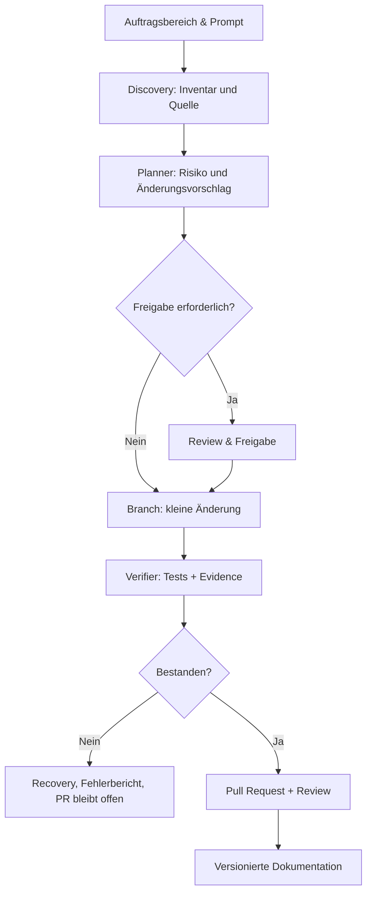

# EDEN Suite · Agenten, Skills und Workflow-Governance

[Startseite](https://github.com/EDEN-STREET) · [17 Prompts](prompts/README.md) · [System-Mindmap](media/EDEN-AGENTEN-MINDMAP.svg)

## Agentenrollen
| Rolle | Aufgabe | Nicht erlaubt |
|---|---|---|
| **Discovery** | Read-only Bestand, Branches, Docs, Quellinventar | Keine Änderungen |
| **Architect** | Komponenten, ADRs, Trust Boundaries, Modelle | Keine automatische Produktivfreigabe |
| **Planner / Coordinator** | Ziele, Abhängigkeiten, Roadmap, Übergaben | Kein impliziter Gerätezugriff |
| **Archivist / Technical Writer** | Provenienz, Historie, Guides, PDF-Register | Kein Upload privater Originale |
| **UI Editor / Accessibility** | Bestehende UIs bewahren und verbessern | Keine Simulation als echte Geräteprüfung |
| **Schema / Builder Engineer** | Skills, JSON-Schemas, Workflows | Keine Ausführung ungeprüfter Inputs |
| **Platform / Network / Mobile Engineer** | Gerätedomäne und Preflight, sichere Entwürfe | Keine nicht autorisierte Systemänderung |
| **Verifier / QA** | Positiv-/Negativtests, Evidence, Regression | Kein frei erfundener Testbericht |
| **Security Reviewer** | Risiken, Datenschutz, Berechtigungen | Kein ungeprüfter Sicherheitsclaim |
| **Integrator / Release Manager** | Branches, PRs, CI, Rollback, Releases | Kein ungeprüfter Merge |

## Workflow-Kette



**Sicherheit:** Berechtigungen rollen- und zeitgebunden, keine automatische Freigabe privilegierter Aktionen durch bloßes Vorliegen eines Prompts. Jede Übergabe nennt den Repo-HEAD, getestete Umgebung und Nachweise.

## Skill-Vertrag – maschinenlesbare Grundstruktur

```yaml
id: eden.example.readonly-inventory
version: 0.1.0
mode: read-only
input_schema: schemas/inventory-input.schema.json
output_schema: schemas/inventory-output.schema.json
permissions: [inventory.read]
preflight: required
dry_run: required
approvals: []
tests: [unit, negative, integration]
evidence: [revision, timestamp, outcome, redaction]
rollback: not-applicable
```

Ein schreibender Skill benötigt zusätzlich explizite Approvals, Backup/Restore, unabhängige Verifikation und rollbackfähige Änderungen.

## Konfiguration

Versionsgebundene Parameter gehören in dokumentierte Schemas statt in versteckte hartcodierte Werte. Versionsänderung an API, Schema oder Workflow verlangt einen Migrationsvermerk und Kompatibilitätstest.

## Arbeitsbereiche
- [01 Strategie](prompts/01-strategy.md)
- [02 Naming](prompts/02-brand.md)
- [03 Provenienz](prompts/03-provenance.md)
- [04 Synchronisation](prompts/04-sync.md)
- [05 Architektur](prompts/05-architecture.md)
- [06 EDEN-Term](prompts/06-terminal.md)
- [07 Builder](prompts/07-builder.md)
- [08 Wiki & PDF](prompts/08-knowledge.md)
- [09 Laptop](prompts/09-laptop.md)
- [10 Router](prompts/10-router.md)
- [11 Mobile](prompts/11-mobile.md)
- [12 Bootstrap](prompts/12-bootstrap.md)
- [13 Demos](prompts/13-previews.md)
- [14 Mindmaps](prompts/14-visuals.md)
- [15 Qualität](prompts/15-quality.md)
- [16 GitHub](prompts/16-github.md)
- [17 Übergabe](prompts/17-handoff.md)
