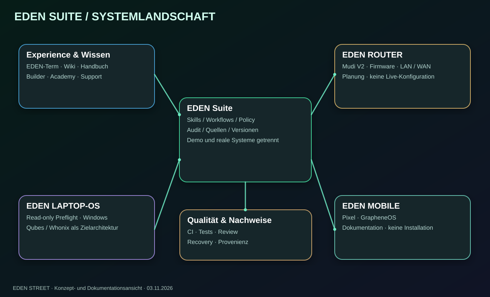
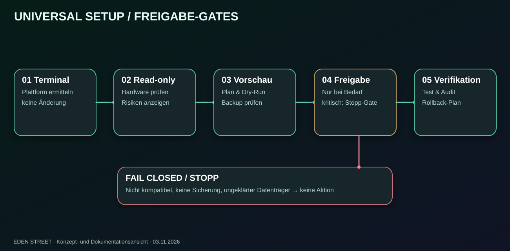
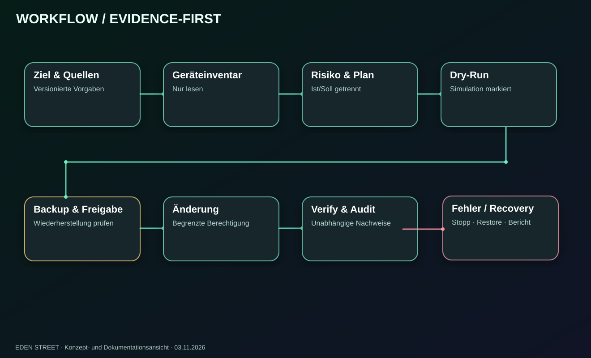
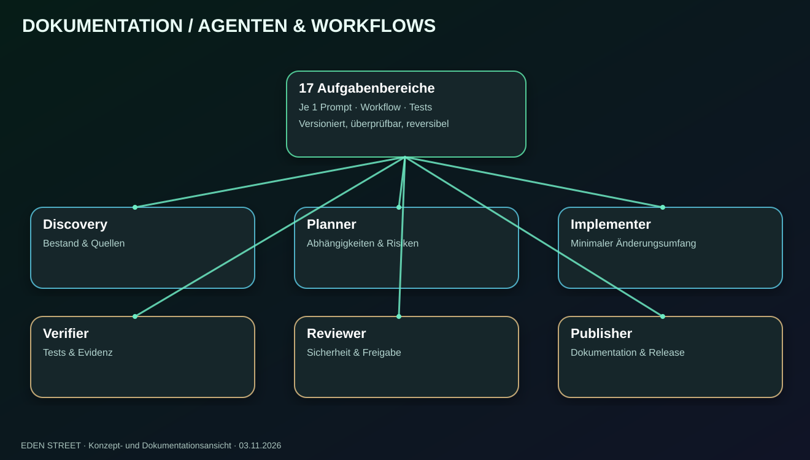
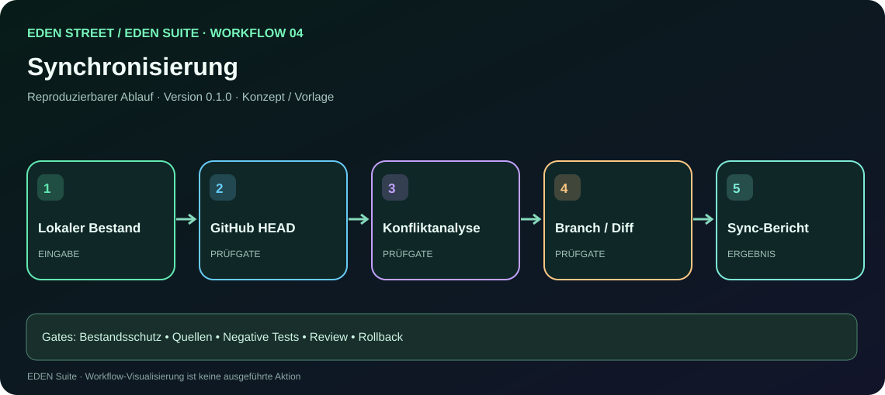
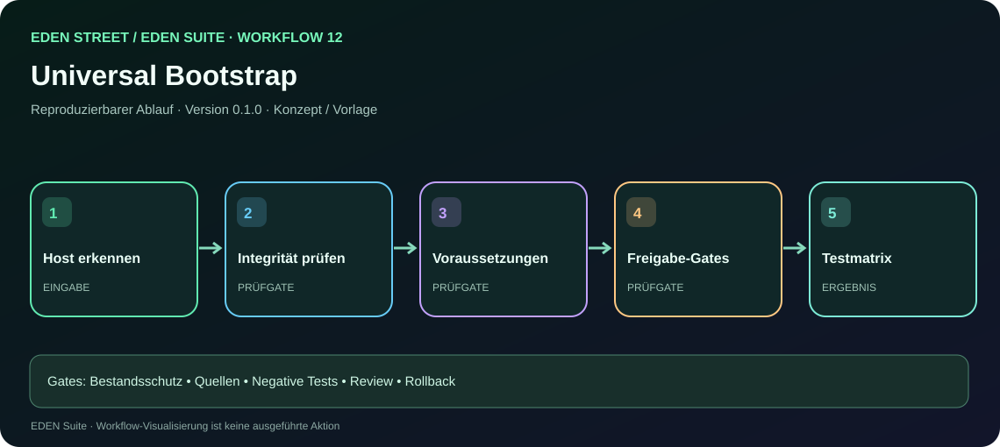
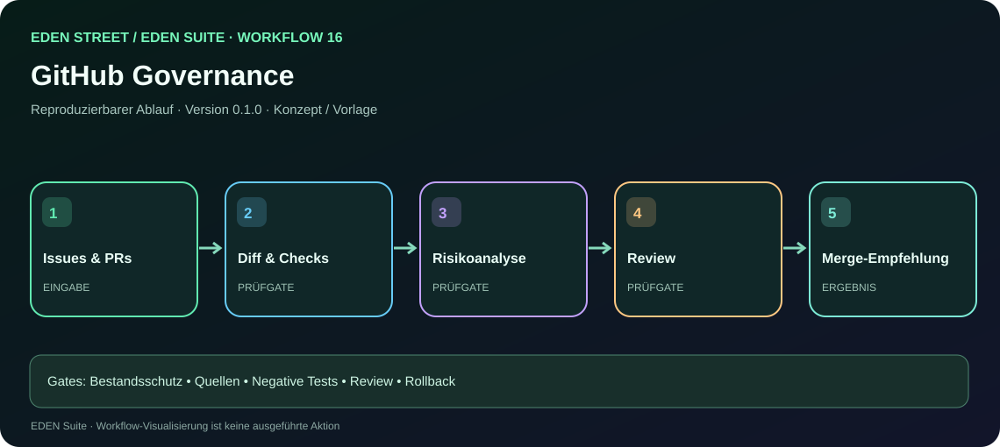

# EDEN Suite — Strukturatlas und Mindmaps
Version 0.1.0 · Dokumentationsentwurf

## Systemgrenzen
```text
[Browser / UI] --request--> [Policy + Approval] --allow--> [Workflow Engine]
       |                             |                         |
       +--> [Guides/Academy]         +--> [Audit]               v
                                                        [Scoped Agent]
                                                              |
                                                   [Device / Service]
                                                              |
                                                        [Verification]
                                                              |
                                                         [Evidence]
```

## Laptop-Erstanschluss
```text
                 INTERNET
                    |
               [HEIMROUTER]
                 /       \
            WLAN          LAN
             |             |
       [HEIMRECHNER]   [LAPTOP]
       Begleitung      Windows zunächst
                       |
                 Read-only Preflight
                       |
                  Gate 5 BLOCKED
                       |
                 Qubes OS (Ziel)
                   /         \
             Whonix         EDEN App Qube
```
Gleiches Netzwerk bedeutet keinen automatischen Fernzugriff. Windows-Fernwartung überlebt keinen OS-Wechsel. Der Mudi V2 wird separat konfiguriert.

## Workflow-Lebenszyklus
```text
[Anforderung]
      |
      v
[Ist-Zustand] -> [Soll-Zustand] -> [Risikoanalyse]
                                       |
                                       v
                                 [Read-only Check]
                                       |
                             +---------+---------+
                             |                   |
                          BLOCKED              PASS
                             |                   |
                         [Bericht]           [Dry-Run]
                                                 |
                                            [Backup-Test]
                                                 |
                                            [Freigabe]
                                                 |
                                           [Ausführung]
                                                 |
                                           [Verifikation]
                                             /       \
                                           PASS      FAIL
                                            |         |
                                          Audit    Recovery
```

## Dokumentations- und Versionsfluss
```text
[Originalquellen] -> [Provenienz] -> [PUBLIC/PRIVATE Review]
                                          |
                               +----------+----------+
                               |                     |
                             PRIVATE                PUBLIC
                               |                     |
                          Kein Upload        [Markdown / PDF]
                                                     |
                                            [Version + Hash]
                                                     |
                                            [Draft PR / Review]
                                                     |
                                            [GitHub Portal]
```

## Vertrauenszonen
```text
ÖFFENTLICH: README / Guides / freigegebene PDFs
INTERN: Entwicklungsdaten / redigierte Testberichte
VERTRAULICH: Secrets / Schlüssel / Identifikatoren
GERÄTE: Privilegierte Änderungen nur mit Freigabe
```
Kein Diagramm ersetzt eine reale Netzwerk- oder Sicherheitstestung.


## Erweiterter visualisierter Atlas

Die bisherigen textuellen Diagramme **bleiben vollständig erhalten**. Zusätzlich gibt es skalierbare SVG-Grafiken, die in GitHub direkt als Bilder sichtbar sind. Inhalt und Dokumentationsstand sind entscheidend, nicht das technische Grafikformat.

### Systemlandschaft
[](media/EDEN-SUITE-SYSTEMLANDSCHAFT.svg)

### Installationsablauf und Freigaben
[](media/EDEN-SETUP-FREIGABEN.svg)

### Sicherheitsworkflow
[](media/EDEN-WORKFLOW-NACHWEISE.svg)

### Agenten und Rollen
[](media/EDEN-AGENTEN-MINDMAP.svg)

### 17 einzelne Arbeitsabläufe
[](workflow.html?id=04)

[](workflow.html?id=12)

[](workflow.html?id=16)

**[Alle 17 Workflow-Grafiken und interaktiven Schrittfolgen](workflows.html)** · [Prompt-Katalog](prompts/README.md)

**Hinweis:** Diese Schemata beschreiben die Entwicklung und geplantermaßen abgesicherte Abläufe. Sie sind keine real gemessene Netzwerkarchitektur oder bestätigte Geräteinstallation.
