# EDEN Suite — Demo-Galerie und Projektansichten
Stand: 2026-11-03 · **Entwicklungsansichten, keine Produktivfreigabe**

Diese Galerie macht die vorhandenen, im Repository nachgewiesenen Demo-Oberflächen auffindbar. Die Layouts bleiben erhalten; auf dem Gate-5-Entwicklungszweig wurden ausschließlich ausgewählte sichtbare Markenbezeichnungen auf **EDEN-Term** aktualisiert. Nicht jede historische Zeichenfolge wurde ersetzt: interne Bezeichner, Pfade, Datenschemata und bestehende Integrationen dürfen nicht blind umbenannt werden.

## Gesamtprojekt
| Oberfläche | Zweck | Demo-Quelle | Zustand |
|---|---|---|---|
| **EDEN-Term / Workbench** | Terminalartige Arbeitsoberfläche, Navigation, Status und Entwickleransicht | [HTML auf Entwicklungszweig](https://github.com/EDEN-STREET/LAPTOP-OS/blob/feature/gate5-universal-preflight-v0.1.0/web/index.html) | Branding teilweise angepasst, Layout beibehalten |
| **Wiki** | Wissensportal und Quellenzugang | [HTML](https://github.com/EDEN-STREET/LAPTOP-OS/blob/feature/gate5-universal-preflight-v0.1.0/web/wiki.html) | Branding teilweise angepasst |
| **Handbuch** | Kapitel und Entwicklungsstand | [HTML](https://github.com/EDEN-STREET/LAPTOP-OS/blob/feature/gate5-universal-preflight-v0.1.0/web/handbuch.html) | Branding teilweise angepasst |
| **Projekte / Kanban** | Modulspuren und Aufgaben | [HTML](https://github.com/EDEN-STREET/LAPTOP-OS/blob/feature/gate5-universal-preflight-v0.1.0/web/projects.html) | unveränderte Ansicht |
| **Builder** | Entwurf von Assistenten und Workflows | [HTML](https://github.com/EDEN-STREET/LAPTOP-OS/blob/feature/gate5-universal-preflight-v0.1.0/web/builder.html) | Branding teilweise angepasst |
| **Quellen** | Quellennavigation und Nachweise | [HTML](https://github.com/EDEN-STREET/LAPTOP-OS/blob/feature/gate5-universal-preflight-v0.1.0/web/quellen.html) | Branding teilweise angepasst |

## Projekt LAPTOP-OS
- [Geführte Windows-Einrichtung — Demo](https://github.com/EDEN-STREET/LAPTOP-OS/blob/feature/gate5-universal-preflight-v0.1.0/web/setup.html)
- [EDEN-Term Workbench — Demo](https://github.com/EDEN-STREET/LAPTOP-OS/blob/feature/gate5-universal-preflight-v0.1.0/web/index.html)
- [Hardware-Preflight — Spezifikation](https://github.com/EDEN-STREET/LAPTOP-OS/blob/feature/gate5-universal-preflight-v0.1.0/docs/gate5/UNIVERSAL-HARDWARE-PREFLIGHT-v0.1.0.md)

## Projekt ROUTER
Eine historische Mudi-V2-PDF und weitere Router-Dokumente sind als Projektmaterial vorhanden. **Noch keine öffentlich geprüfte eigenständige Router-Demo auf GitHub verifiziert.** Nicht mit einer Laptop-Demo verwechseln.

## Projekt MOBILE / PIXEL
GrapheneOS-Anleitungen sind als Projektmaterial vorhanden. **Noch keine öffentlich geprüfte eigenständige Mobile-Demo auf GitHub verifiziert.**

## Weitere historische Entwürfe aus Projektmaterial
- **DkZ_EDEN_Terminal_Demo.html**: separates HTML-Original mit dunkler Terminaloberfläche, Ghostty-/Zellij-/Herdr-Bezügen. Als Projektdatei verfügbar, aber nicht ungeprüft öffentlich kopiert. Die neue Markenbezeichnung ist **EDEN-Term**.
- **EDEN Security Platform v0.2/v0.3**: historische Demo-/Builder-Pakete werden in den Projektunterlagen beschrieben; ihre vollständigen Originalarchive sind hier noch nicht als öffentliche, überprüfte GitHub-Dateien nachgewiesen.
- **Mindmaps und Systemdiagramme** bezeichnen den Inhalt; die textbasierte Darstellung ist lediglich das Format.

## Darstellung im GitHub-Portal
GitHub zeigt HTML-Dateien primär als Quelltext und nicht als ausgeführte App. Die Links oben sind deshalb **Quellansichten**, keine Live-Demo-URLs. Für echte interaktive Vorschauen sind ein sicherer statischer Demo-Host oder der dokumentierte lokale npm-Start sowie Browser-/Sichtprüfungen erforderlich. Screenshots werden erst nach echter Renderprüfung als Abbildungen eingebunden. Keine Screenshots oder Qualitätsnachweise erfinden.

## Regeln für die schonende Überarbeitung
1. Historische Originale unverändert archivieren; bestehende Layouts, Farben und Interaktionen bewahren.
2. Sichtbare Namen auf EDEN STREET (Marke), EDEN Suite (Gesamtplattform), EDEN-Term (Terminal) korrigieren.
3. Mindmap, Architekturübersicht, Workflow-Diagramm und Netzwerkübersicht als **inhaltliche Titel** verwenden.
4. Interne IDs, API-Namen und Dateipfade nur mit Migrationsplan ändern.
5. Responsive Darstellung, Kontrast, Tastaturbedienung und Bildschärfe testen; keine ungeprüften „hochrendert“-Behauptungen.
6. Änderungen über Feature-Branch, Testbericht, Screenshots, Review und Freigabe nach `main` übernehmen.

## Noch offen
Vollständige historische Demo-Inventur, tatsächliche Browser-Screenshots, visuelle Vorher-/Nachher-Diffs, UI-End-to-End-Tests, Veröffentlichung von Live-Demos und getrennte Projektgalerien für Router und Mobile.

## 14 Vorschaukacheln mit klickbarer HTML-Oberfläche

Die statischen Kopien der früheren EDEN-Demos liegen jetzt im Portal-Repository unter `docs/legacy/`. Das Umschaltfenster [`docs/preview.html`](preview.html) bietet Links und ein `iframe` für die vollständigen Ansichten. Die gesonderte [Konzept-Demo](concept-demo.html) für ROUTER, MOBILE, Suite und Academy simuliert nur UI-Zustände.

| Bereich | Vorschaubild | HTML-Datei | Status |
|---|---|---|---|
| EDEN-Term | [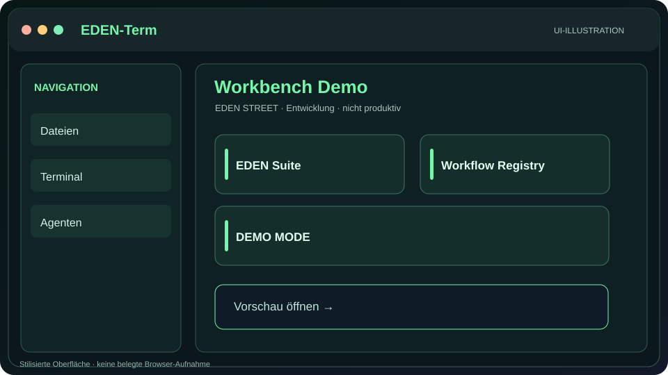](preview.html?surface=terminal) | [Workbench](legacy/index.html) | Bestehende HTML-Demo |
| EDEN Wiki | [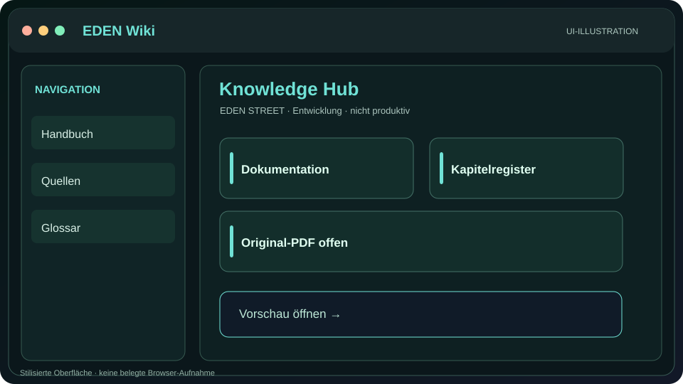](preview.html?surface=wiki) | [Wiki](legacy/wiki.html) | Bestehende HTML-Demo |
| EDEN Handbuch | [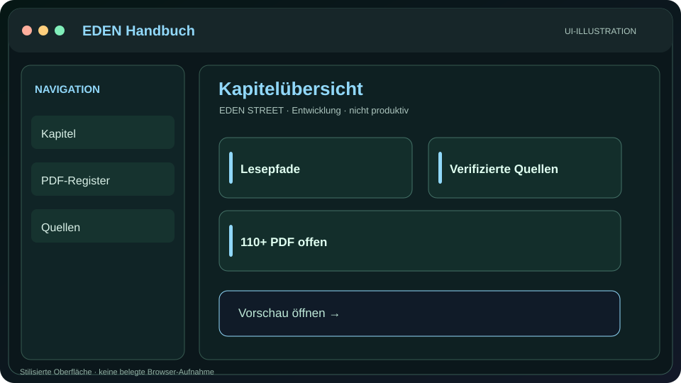](preview.html?surface=handbuch) | [Handbuch](legacy/handbuch.html) | Bestehende HTML-Demo |
| EDEN Builder | [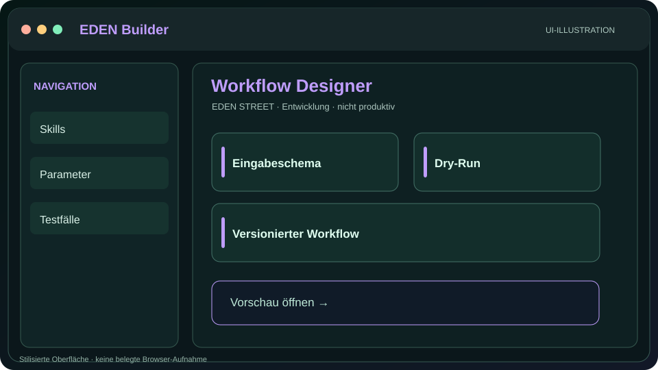](preview.html?surface=builder) | [Builder](legacy/builder.html) | Bestehende HTML-Demo |
| Projekte / Kanban | [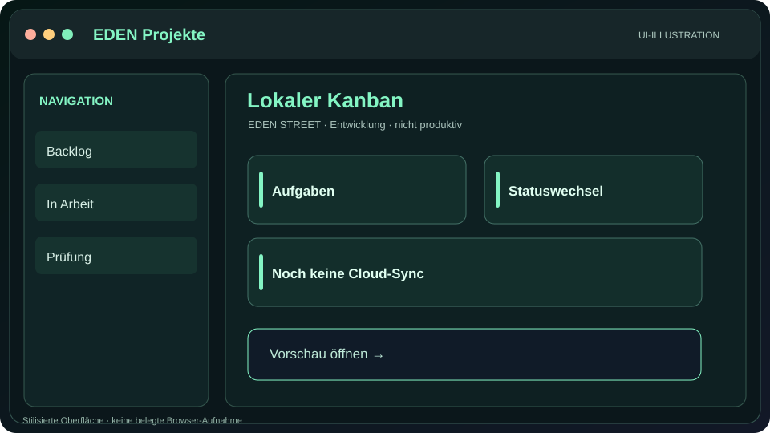](preview.html?surface=projects) | [Kanban](legacy/projects.html) | Bestehende HTML-Demo |
| Setup | [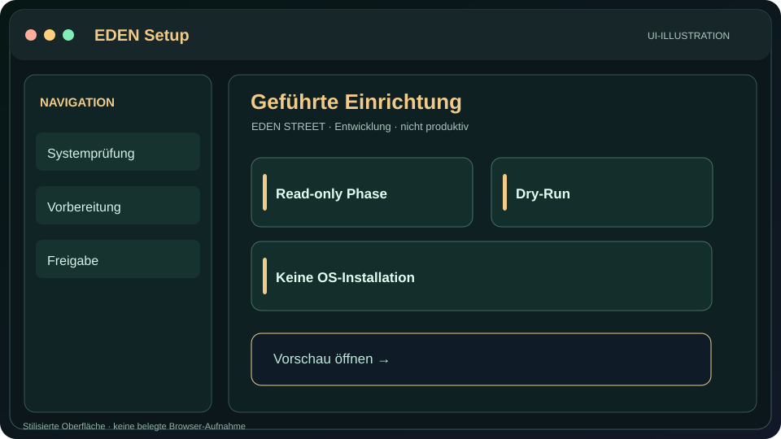](preview.html?surface=setup) | [Setup](legacy/setup.html) | Bestehende HTML-Demo |
| Quellen | [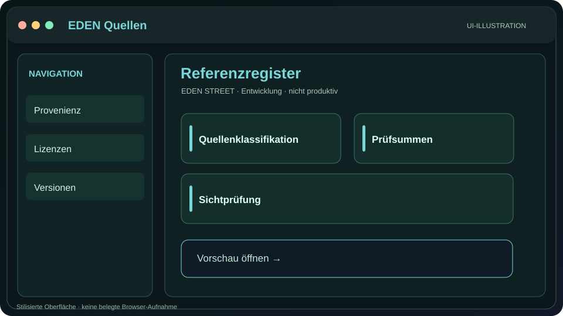](preview.html?surface=quellen) | [Quellen](legacy/quellen.html) | Bestehende HTML-Demo |
| Toolbox | [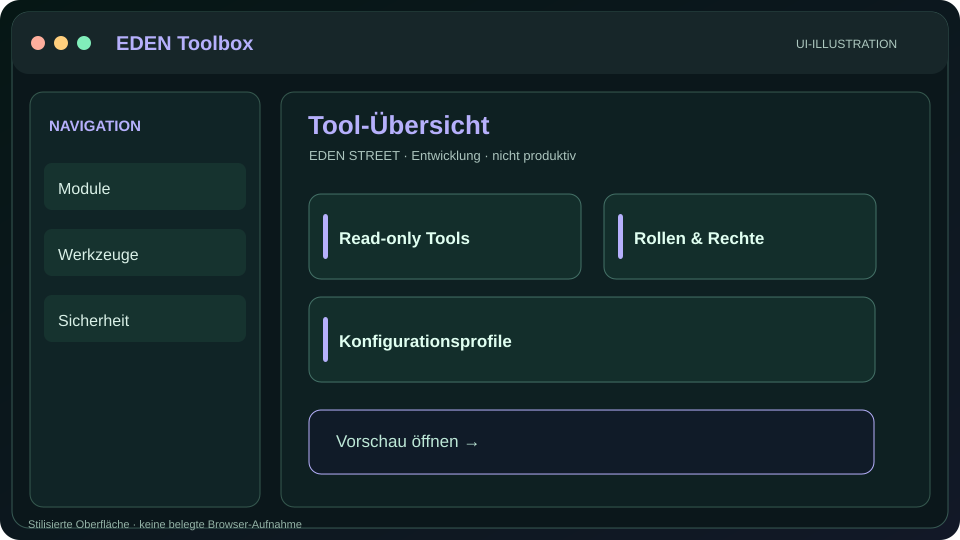](preview.html?surface=toolbox) | [Toolbox](legacy/toolbox.html) | Bestehende HTML-Demo |
| Grimoire | [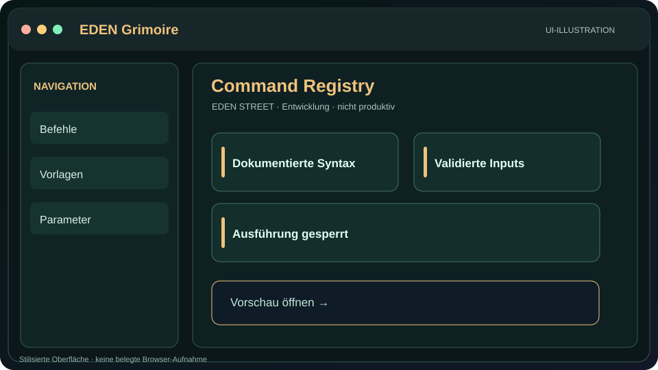](preview.html?surface=grimoire) | [Grimoire](legacy/grimoire.html) | Bestehende HTML-Demo |
| Testlab | [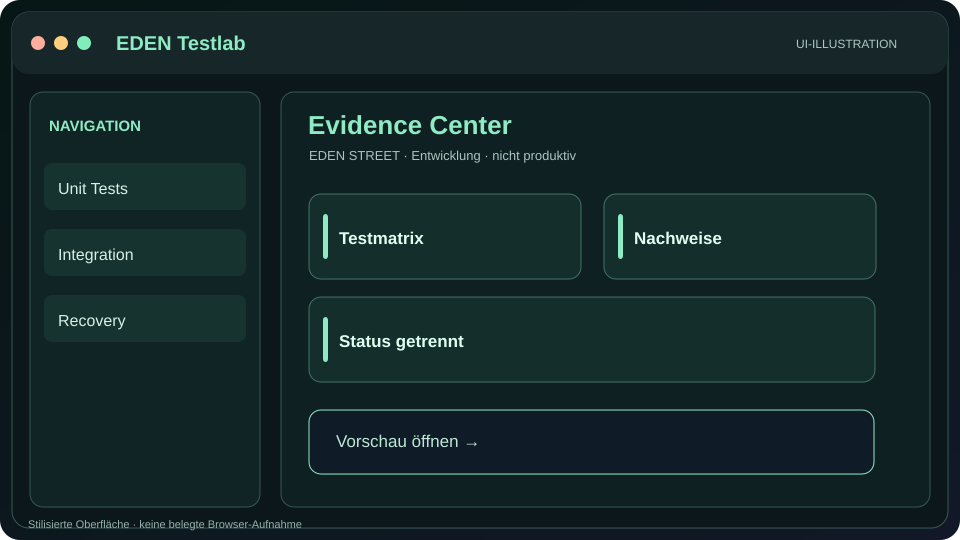](preview.html?surface=testlab) | [Testlab](legacy/testlab.html) | Bestehende HTML-Demo |
| ROUTER | [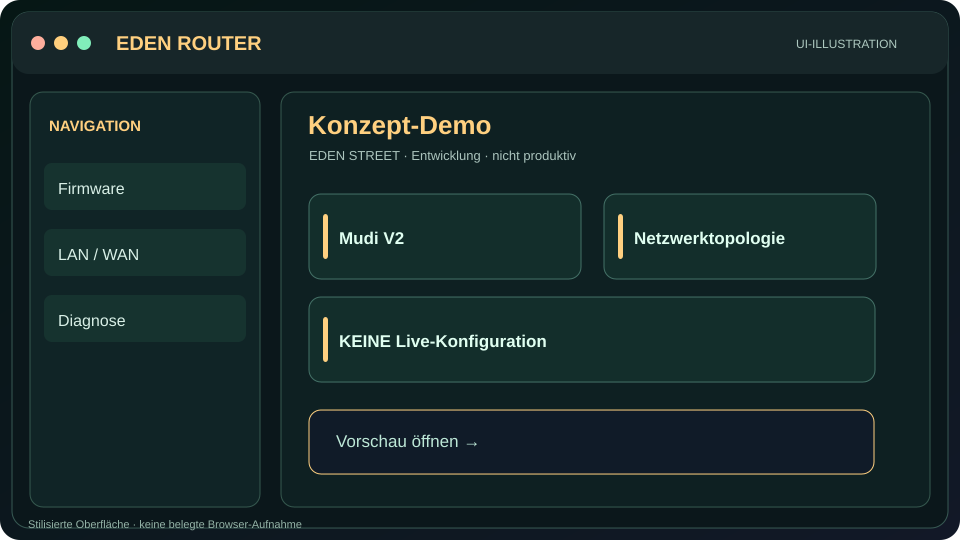](preview.html?surface=router) | [Konzept](concept-demo.html?surface=router) | Simulation |
| MOBILE | [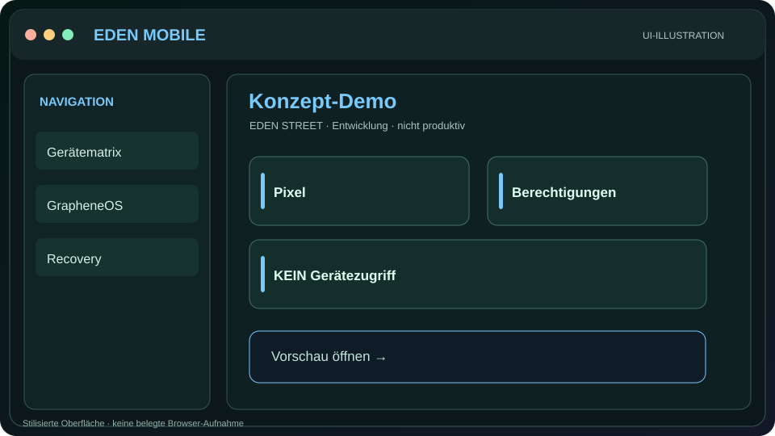](preview.html?surface=mobile) | [Konzept](concept-demo.html?surface=mobile) | Simulation |
| Suite | [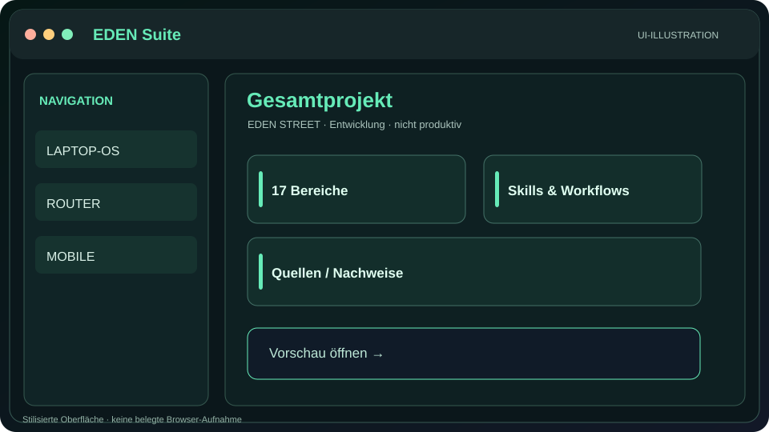](preview.html?surface=suite) | [Konzept](concept-demo.html?surface=suite) | Simulation |
| Academy | [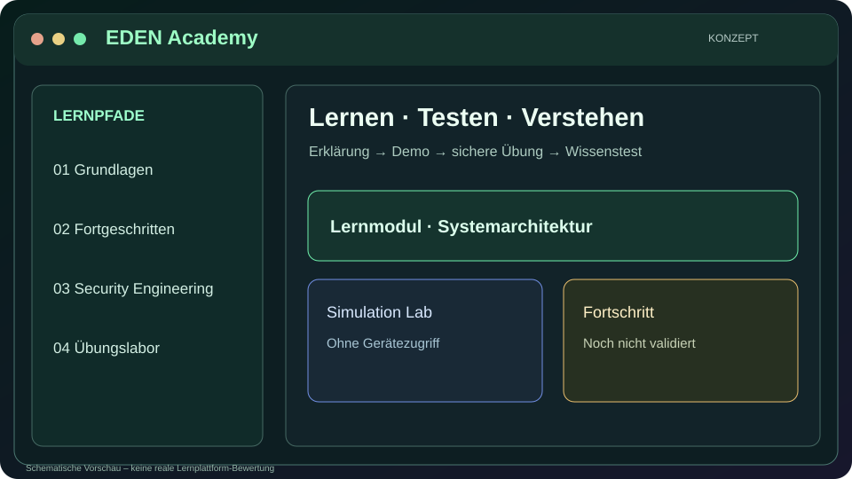](preview.html?surface=academy) | [Konzept](concept-demo.html?surface=academy) | Simulation |

**Wichtig:** Die Bilder sind stilisierte Visualisierungen, keine realen Browser-Screenshots. GitHub stellt HTML-Dateien in der Datei-Ansicht als Quelltext dar; das Ausführen des `iframe`-Portals erfordert einen aktiven Webhost. Für Pages siehe [Hosting-Anleitung](PAGES-UND-REPOSITORIES.md).

## Workflow-Vorschauen

[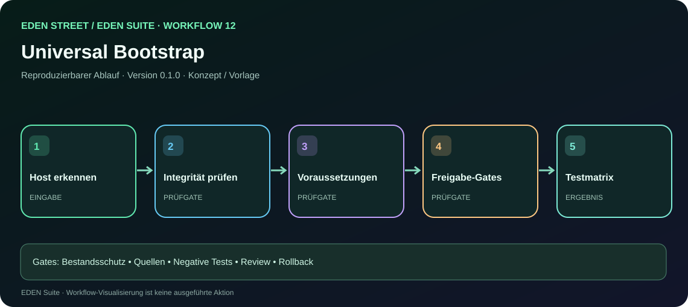](workflow.html?id=12)

[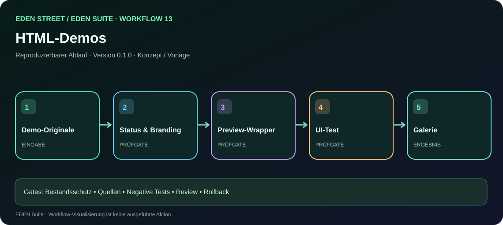](workflow.html?id=13)

**[Alle 17 Abläufe](workflows.html)** · [Bedienungsanleitungen](prompts/README.md)
