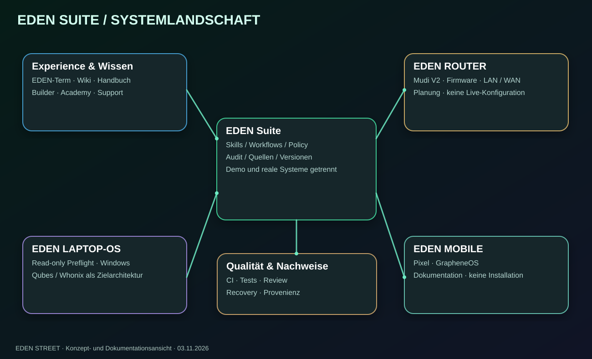
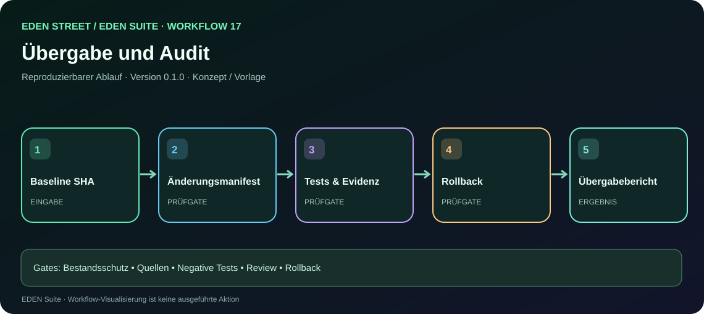
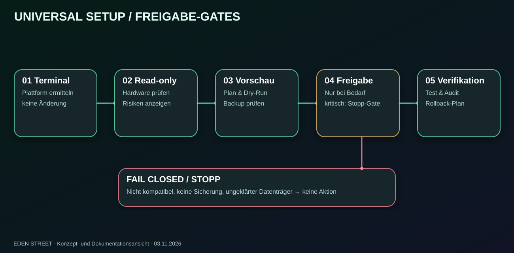
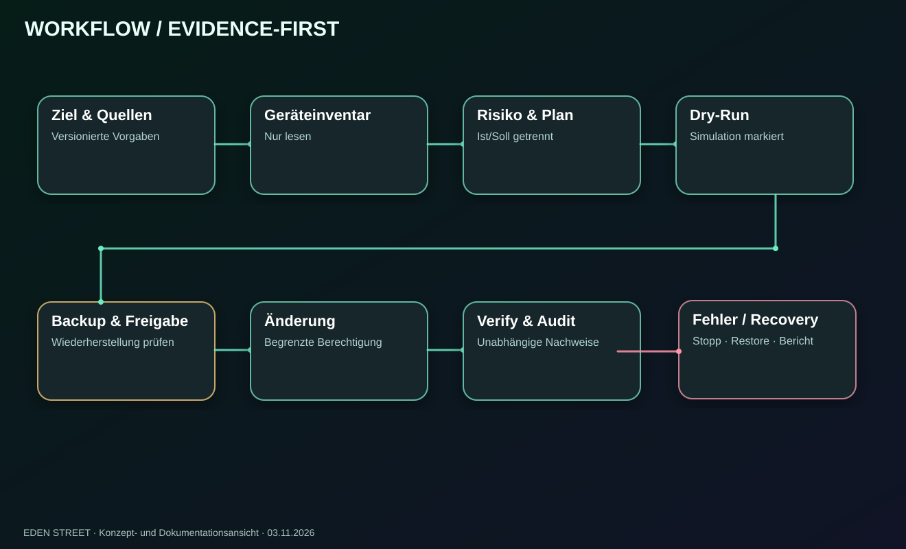

# EDEN STREET — Masterdokumentation in 17 Arbeitsbereichen

**EDEN Suite | Version 0.2.0 (Dokumentationsstand) | 03.11.2026 | Status: laufender Ausbau**

[🏠 Projektstartseite](https://github.com/EDEN-STREET) · [🧭 Online-Vorschau (Quellseite)](https://github.com/EDEN-STREET/.github/blob/main/docs/index.html) · [📖 Wiki](WIKI.md) · [🎨 Diagramme](EDEN-ASCII-ATLAS.md) · [🖥️ Demo-Galerie](EDEN-DEMO-GALERIE.md)

> **Bestandsschutz:** Dieses Dokument ergänzt bestehende Projektquellen und Releases. Es behauptet weder eine vollständige Geräteinstallation noch eine Freigabe der historischen Handbuch-PDF.

## Visuelle Einstiegskarte

[Oberflächengalerie mit Bildern](areas/README.md) · [Workflow-Galerie](workflows.html) · [Agenten](AGENTEN-UND-WORKFLOWS.md) · [Maschinenlesbares Register](workflows/manifest.json)

## 01 · Vision, Mission und Geltungsbereich
EDEN STREET ist die Marke und GitHub-Organisation. EDEN Suite ist die gemeinsame Plattform für dokumentierte Geräteeinrichtung, Inventarisierung, reproduzierbare Sicherheits-Workflows, Wiki, Handbuch, Academy, Support, Builder, Audit und Visualisierung. EDEN LAPTOP-OS, EDEN ROUTER und EDEN MOBILE sind getrennte Gerätedomänen.

## 02 · Offizielle Namen und Rückwärtskompatibilität
- EDEN STREET = Dachmarke, EDEN Suite = Produkt, EDEN-Term = Terminal-/Workbench-Oberfläche.
- EDEN Wiki, EDEN Handbuch, EDEN Builder, EDEN Academy, EDEN Skills & Workflows.
- Frühere Produktnamen bleiben als nachvollziehbare historische Referenzen erhalten. Interne IDs, Dateinamen, CSS-Selektoren und Schnittstellen nur mit Migrationsplan verändern.
- Ein Diagramm heißt nach seinem Inhalt Mindmap, Systemarchitektur, Netzwerkübersicht oder Workflow-Diagramm – nicht nach seinem Dateiformat.

## 03 · Versions- und Quelleninventar
Für jedes Artefakt: ID, Herkunft, Datum, Lizenz, Datenklasse, SHA-256, Git-Revision, öffentliche Freigabe und abweichende Versionen erfassen. Historische Prototypen v0.2/v0.3, V0.8.0-Vorschau und neue dokumentierte Änderungen nicht vermengen. Originale unverändert sichern.

## 04 · Bestandsaufnahme vor Änderungen
Vor jeder Arbeit lokale Git-Änderungen, Remote-Branches, Commits, Issues, PRs, Releases, Tests, Dokumentationen und Demo-Dateien vergleichen. Konfliktmatrix erzeugen, anschließend inkrementell planen. Kein älterer lokaler Stand darf jüngere freigegebene Dateien ersetzen.

## 05 · Modulare Architektur
**Experience:** Portal, EDEN-Term, Setup, Wiki, Handbuch, Academy, Support, Simulation Lab.

**Platform:** Identity, Inventory, Policy, Skill Registry, Workflow Engine, Evidence/Audit, Release Catalog.

**Devices:** LAPTOP-OS (Windows-Leseprüfung, Qubes/Whonix-Zielarchitektur), ROUTER (Mudi V2), MOBILE (Pixel/GrapheneOS-Zielstrecke).

**Operations:** CI, Tests, Risikoanalyse, Recovery, Dokumentation, Quellenprüfung.

## 06 · EDEN-Term und Dashboard
Einsteiger- und Entwickleransicht, durchsuchbare Module, Laufzeitstatus, Geräte- und Projektübersicht, Diagnose, Aufträge, Freigaben, Nachweise, Logs. Jede Funktion kennzeichnet **Konzept / Demo / Implementiert / automatisiert getestet / hardwaregetestet / freigegeben / blockiert** eindeutig.

## 07 · EDEN Builder und Datenmodell
Builder für Assistenten, Fragebögen, Skills und Workflows auf gemeinsamem versioniertem Schema. Skills definieren Input, Output, Berechtigungen, Vorbedingungen, Parameter, Tests, Fehlerfälle, Recovery. Workflows referenzieren feste Skill-Versionen und trennen Vorschau von realer Ausführung.

## 08 · Wiki, Handbuch und Provenienz
Originalquellen, Kapitelindex, Suche, Glossar, Reviews, öffentlich/privat-Klassifizierung, PDF-Register und Offlinekonzept. **Die originale 110+-seitige Handbuch-PDF ist noch nicht nachweislich vorhanden** und darf nicht durch die zehnseitige Mudi-Unterlage ersetzt werden.

## 09 · LAPTOP-OS
Bestehenden npm-Vorschaustarter und Webansichten bewahren. Gate-5-Preflight für CPU-Virtualisierung, IOMMU, UEFI, Speicher, kompatible Geräte, Backup, verifizierte Installationsmedien, Zielpartition und ausdrückliche Zustimmung. Ein Anwendungskommando installiert keine neue Betriebssystemumgebung.

## 10 · ROUTER
Eigene Gerätedomäne und vorgeschlagene Repo-Bezeichnung `ROUTER`. Mudi-V2-Firmwarestand, WAN/LAN, Firewall, DNS, VPN, Segmentierung, Konfigurationsbackup, Tests und Wiederherstellung modellieren. **Projekt-/Demoansicht ist vorläufig; keinerlei Routeränderungen ausgeführt.**

## 11 · MOBILE
Eigene Gerätedomäne und vorgeschlagene Repo-Bezeichnung `MOBILE`. Geräte- und Versionstabelle, GrapheneOS-Dokumentation, Berechtigungen, Update-, Backup- und Recovery-Pfade. **Keine echte Geräteinstallation und keine Bootloaderänderung erfolgt.**

## 12 · Universal Bootstrap und Einsteigerführung
Ziel: möglichst einfacher Start über die jeweilige Kommandozeile, Plattform- und Architektur-Erkennung, Integritätsprüfung, Voraussetzungen, UI-Assistent, wiederaufnehmbare nicht-destruktive Schritte, Audit. Kritische Speicher-/Firmware-Aktionen benötigen getrennte Genehmigung. Ein Ein-Zeilen-Befehl ist erst nach realen Plattformtests zu veröffentlichen.

## 13 · Interaktive HTML-Vorschauen
Bestehende Original-Demos unverändert erhalten. Im Portal gibt es separate **sichtbar simulierte, klickbare** Entwurfsansichten für EDEN-Term, Wiki, Handbuch, Builder, Setup, Projekte, Router und Mobile. Sie sind keine realen Gerätescanner oder produktive Installer. Für öffentliche URL GitHub Pages aus `main /docs` separat aktivieren und Deployment prüfen.

## 14 · Mindmaps, Systempläne und Netzwerkbilder
SVG mit Titel, Legende, Textalternative und dokumentierter Quelle; zusätzlich editierbare Graphen/Text-Diagramme. Karten für Gesamtarchitektur, Geräte, Installer, Verifikation, Wissensfluss und Modulabhängigkeiten. Bereits vorhandene Grafiken nicht entfernen.

## 15 · Tests, Sicherheit und Abnahme
CI für unterstützte Systeme, npm-Test, Paketprüfung, Browser-/Accessibility-Tests, negative Tests, Backups, Restore, datensparsame Protokolle, SHA-256 und Prüfrevisionen. Simulationen und historische Testergebnisse niemals als aktuelle Hardwaretests darstellen.

## 16 · GitHub: Repositories, Issues, Pull Requests und Reviews
Aktuell verifiziert: `EDEN-STREET/.github` und `EDEN-STREET/LAPTOP-OS`. ROUTER/MOBILE sollen separat angelegt werden; falls die verbundene Schnittstelle keine Repo-Erstellung anbietet, Erstellung blockiert melden statt sie zu behaupten.

LAPTOP-OS: Issue [#4 Wiki](https://github.com/EDEN-STREET/LAPTOP-OS/issues/4), [#5 Handbuch](https://github.com/EDEN-STREET/LAPTOP-OS/issues/5), [#6 Kanban](https://github.com/EDEN-STREET/LAPTOP-OS/issues/6), [#7 CI](https://github.com/EDEN-STREET/LAPTOP-OS/issues/7). [PR #8](https://github.com/EDEN-STREET/LAPTOP-OS/pull/8): CI-Fix, erst nach grünen Checks mergen. [PR #9](https://github.com/EDEN-STREET/LAPTOP-OS/pull/9): Gate-5-Draft, nicht vorzeitig freigeben. [PR #3](https://github.com/EDEN-STREET/LAPTOP-OS/pull/3): früher geschlossen/gemergt.

## 17 · Zusammenarbeit, Freigaben und reproduzierbarer Übergabebericht
Für jede Änderung: Istzustand, Basis-Commit, Ziel, Diff, Risiken, Versionsänderung, Tests mit konkretem Ergebnis, Review, Freigabe, Rollback, Dokumentation und Follow-ups. Für nicht auflösbare Konflikte eine übertragbare Frage mit Link und Commit-ID formulieren; keine angebliche direkte Kommunikation zwischen Entwicklungsumgebungen behaupten. Kein automatischer Merge und keine gefährliche Geräteänderung.

---

## Definition of Done (für jede Umsetzung)
- Quelle/Version nachvollziehbar · historische Dateien erhalten · keine vertraulichen Uploads
- Status korrekt gekennzeichnet · Tastatur/Responsive geprüft · Links gültig
- Tests tatsächlich durchgeführt · negative Tests vorhanden · Rollback dokumentiert
- Änderung im Feature-Branch oder dokumentierter Portalkorrektur · Freigabe und Releasebezug

**Lesepfade:** [Einsteiger → Demo](index.html) · [Wiki](WIKI.md) · [Demo-Galerie](EDEN-DEMO-GALERIE.md) · [technischer Masterplan](EDEN-EXTENDED-MASTERPLAN.md) · [Register](EDEN-DOKUMENTATIONSREGISTER.md)
