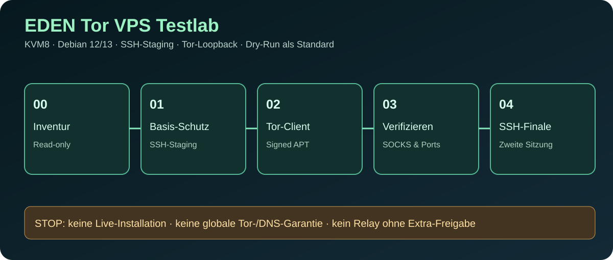

# EDEN Tor VPS Testlab v0.1.0 – KVM8 Debian-Härtungsplan

**Status: ENTWICKLUNG / NO LIVE INSTALLATION** · [EDEN Suite](index.html) · [Sicherheitsworkflow](TOR-VPS-AGENT-WORKFLOW.md) · [LLM-Anweisungen](TOR-VPS-TESTLAB-llms.txt)

## Zweck

Ein Debian-12-/Debian-13-Test-VPS (KVM8-Provider-Tarif) erhält in kontrollierten Phasen einen separaten Administrator, SSH-Key-Authentifizierung, UFW-/Sysctl-Grundkonfiguration, Fail2ban, AppArmor und einen lokal gebundenen Tor-Client. **Kein neues Betriebssystem wird durch die Skripte installiert.** Kein Host wird automatisch aus diesem Repository verändert.

## Vorgesehenes, lokal vorbereitetes Skriptpaket

`EDEN_TOR_VPS_KVM8_TESTLAB_v0.1.0.zip` wurde im begleitenden Projektgespräch erzeugt, inklusive ausführbarer Dateien:

- `scripts/00_preflight.sh` – lesende Inventur
- `scripts/01_bootstrap_hardening.sh` – zwei SSH-Ports während der Übergangsphase, Benutzer, Key, Firewall- und Kernel-Basis
- `scripts/02_install_tor.sh` – offizielle signierte Tor Project APT-Quelle, Client/optionale Onion-Demo
- `scripts/03_verify_tor_os.sh` – SOCKS5-IP-Abfrage, Dienst-, Port- und Limitierungsstatus
- `scripts/04_finalize_ssh.sh` – Passwort-/Root-Login erst nach bestätigter Konsole und zweitem Schlüssellogin deaktivieren
- `lib/common.sh`, `config/*.example`, Bedienungsanleitung, Recovery, SVG und Tests

**ZIP SHA-256:** `f6e382aeb5305510ede1aad4117e1316b8b420abed7949798b593c8d1424f1b8`.

**Achtung:** Die ZIP-Datei ist ein in der Unterhaltung erzeugtes Artefakt, **noch kein GitHub-Release**. Die Dateien müssen vor einem Repository-Release unverändert in `labs/tor-vps/` importiert und in GitHub-CI erneut geprüft werden. Die Checksumme dient zur späteren Identitätsprüfung, ist jedoch keine digitale Signatur oder unabhängige Herkunftsbestätigung.

## Sicherheitsgates

1. Read-only Hardware- und OS-Inventur: tatsächlicher VPS-Tarif, Debian-Kennung, verfügbare Ressourcen, SSH-Ports.
2. Provider-Snapshot, Serverkonsole, Admin-Key, aktuelle Cloud-Firewall: separat bestätigen.
3. Paketinstallation und SSH-Staging; niemals Root/Passwortlogin im selben Schritt ohne zweiten Zugang deaktivieren.
4. Tor-Keyring und Paket-Signaturen prüfen; SOCKS/DNSPort an Loopback binden.
5. Externe IsTor-Prüfung über SOCKS5 mit remote DNS, Listener-/Service-Checks.
6. Zweiter SSH-Login aus einem anderen Terminal vor finaler SSH-Härtung.
7. Evidenzbericht mit **PASS / UNKNOWN / BLOCKED** und Rückweg.

## Modi

**A: client** – lokaler SOCKS5-Proxy und optionale DNSPort-Schnittstelle. Keine Tor-Zwangsleitung aller Programme.

**B: onion** – optionales öffentlich erreichbares Onion-v3-Demoangebot mit rein statischen Testinformationen; localhost-only HTTP-Port.

**C: relay-plan** – nur nicht-aktive Konfigurationsvorlage, keine öffentlich geöffneten ORPorts/Bridges. Betreiberpflichten und Provider-AGB gesondert prüfen.

## Ausdrückliche Grenzen

- `ufw default allow outgoing` ist zunächst absichtlich gewählt, um Tor-Bootstrap, APT und SSH-Recovery nicht durch ein ungetestetes Egress-Blockieren zu zerstören. **Keine systemweite DNS-Leak- oder Anonymitätsgarantie.**
- Kein Root-, SSH- oder Router-Kontakt von GitHub bzw. dieser Unterhaltung auf einen echten KVM8-VPS.
- Kein `curl | bash`, keine Secrets, privaten SSH-Keys oder .onion-Keymaterialien im Git.
- Debian 13 ist gegenwärtig stable; Debian 12 ist LTS bis 30. Juni 2028.
- Ein initial grün geprüfter HTTP-/Tor-Proxytest ist kein vollständiger System-Härtungsnachweis.

## Reproduzierbare Integration

Die Review-Branch-Arbeit wird erst nach dem Import des Skriptpakets und erneutem CI-/Shellcheck-Lauf als implementiert geführt. [Agenten-Workflow](TOR-VPS-AGENT-WORKFLOW.md).

## Autoritative Dokumentation

- https://support.torproject.org/little-t-tor/getting-started/installing/
- https://community.torproject.org/onion-services/setup/
- https://community.torproject.org/relay/setup/bridge/
- https://www.debian.org/News/2026/20260712
