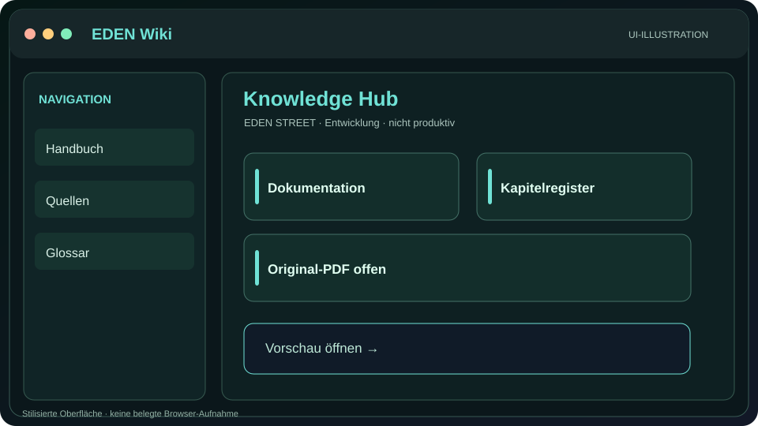
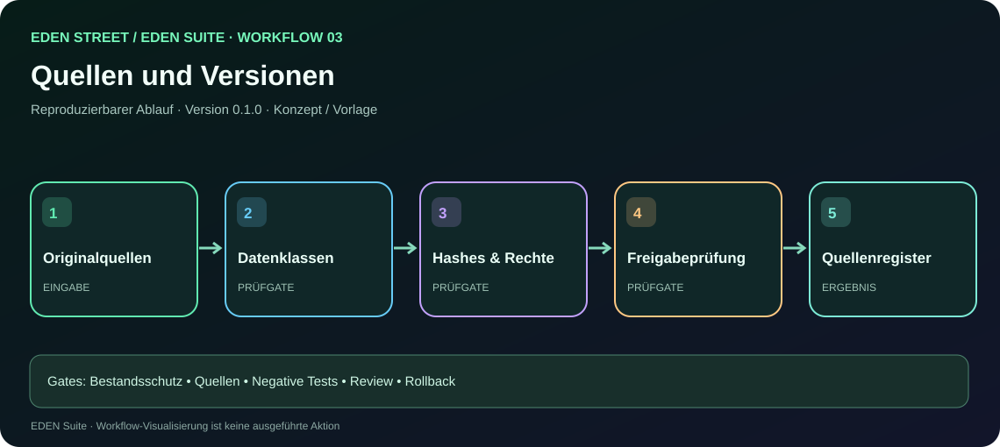
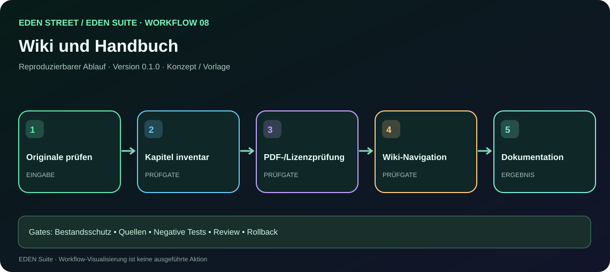

# EDEN Wiki – öffentliches Wissensportal

[🌿 EDEN STREET](https://github.com/EDEN-STREET) · [🖥️ Interaktives Wiki](wiki.html) · [📘 Masterdokumentation – 17 Bereiche](EDEN-STREET-MASTERDOKUMENTATION.md) · [🖥️ Vorschauportal](index.html) · [📑 Dokumentenregister](EDEN-DOKUMENTATIONSREGISTER.md)

**[Wiki als HTML öffnen](wiki.html?tab=wiki)** · [Handbuchtab](wiki.html?tab=handbuch) · [PDF-Status](wiki.html?tab=pdf)

## Inhaltsverzeichnis
| Bereich | Verfügbarkeit |
|---|---|
| [Gesamtdokumentation in 17 Bereichen](EDEN-STREET-MASTERDOKUMENTATION.md) | Öffentlich als Markdown |
| [EDEN Suite Masterplan](EDEN-EXTENDED-MASTERPLAN.md) | Öffentlich als Markdown |
| [Mindmaps und Systemarchitektur](EDEN-ASCII-ATLAS.md) | Textpläne vorhanden, SVG-Ansichten ergänzt |
| [Interaktive Demo-Galerie](EDEN-DEMO-GALERIE.md) | Demo-Dateien vorbereitet; öffentliche URL hängt von Pages ab |
| [Handbuch- und PDF-Register](EDEN-DOKUMENTATIONSREGISTER.md) | Original-Volltext noch offen |
| [LAPTOP-OS Handbuchstruktur](https://github.com/EDEN-STREET/LAPTOP-OS/blob/main/docs/WIKI_UND_HANDBUCH.md) | Öffentlich |
| [ROUTER Projektstand](projects/ROUTER.md) | Vorbereitete Projektübersicht |
| [MOBILE Projektstand](projects/MOBILE.md) | Vorbereitete Projektübersicht |

## Historisches Handbuch (110+ Seiten)
**Noch nicht eingebettet:** Die echte Original-PDF konnte im verifizierbaren Projektbestand nicht gefunden werden. Die einzige derzeit in dieser Bearbeitung vorliegende PDF mit klarer Kennung `MUDI V2` hat **10 Seiten**, betrifft den Router und ist kein Ersatz für das EDEN-Gesamthandbuch.

Nach Erhalt des Originals:
1. Herkunft, Rechte, sensible Inhalte, Metadaten und Vollständigkeit prüfen.
2. Seitenzahl und SHA-256 dokumentieren.
3. Original unverändert archivieren, ggf. datenschutzgeprüfte öffentliche Lesefassung erzeugen.
4. PDF im Wiki verlinken sowie eine Browser-Vorschau mit echter PDF-Datei anbieten.
5. Kapitelnavigation und Suchindex ergänzen.

Kein Platzhalter wird als echte PDF-Ausgabe ausgegeben.

## Benutzung der Vorschauen
In der geplanten Pages-Ansicht ist jede Demo als **DEMO – simulierte UI** markiert. Buttons demonstrieren die Benutzerführung, nicht die reale Geräteinteraktion. Änderungen an Routern, Festplatten, Firmware und Bootloadern sind nicht möglich.

## Redaktionelle Regeln
Jeder technische Artikel nennt Quelle, Stand, Status (Konzept/Demo/Verifiziert), Voraussetzungen, Fehlermöglichkeiten und sichere Rückkehr. Private Forschungs- und Geräteinformationen bleiben außerhalb des öffentlichen Wiki.

## Visuelle Wiki- und Arbeitsablauf-Navigation

**[Wiki-Demo (HTML-Quellansicht)](preview.html?surface=wiki)** · **[17-Workflow-Galerie](workflows.html)** · [Wiki-LLM-Einstieg](areas/wiki/llms.txt)

Für die vollständige historisch beschriebene Handbuch-PDF ist weiterhin das überprüfte Original erforderlich; eine noch nicht vorhandene PDF wird weder künstlich eingebettet noch als veröffentlicht gekennzeichnet.
