# EDEN Suite – alle Oberflächen, Vorschaubilder und Workflows

**15 dokumentierte Bereiche** · vorhandene HTML-Demos und getrennte Konzept-Simulationen · Stand: 2026-11-03

[← Projektportal](../index.html) · [Demo-Galerie](../EDEN-DEMO-GALERIE.md) · [17 Workflows](../workflows.html) · [Masterdokumentation](../EDEN-STREET-MASTERDOKUMENTATION.md) · [Bereichs-llms.txt](llms.txt)

> Jede Vorschau ist eine **schematische SVG-Illustration** und kein realer Screenshot. Die Seite dahinter enthält weitere Projektdaten, Status, Workflow-Grafik und eine maschinenlesbare Arbeitsanweisung. HTML-Demos benötigen GitHub Pages oder einen anderen Webserver.

| Vorschau | EDEN Bereich | Beschreibung und Einstieg |
|---|---|---|
| [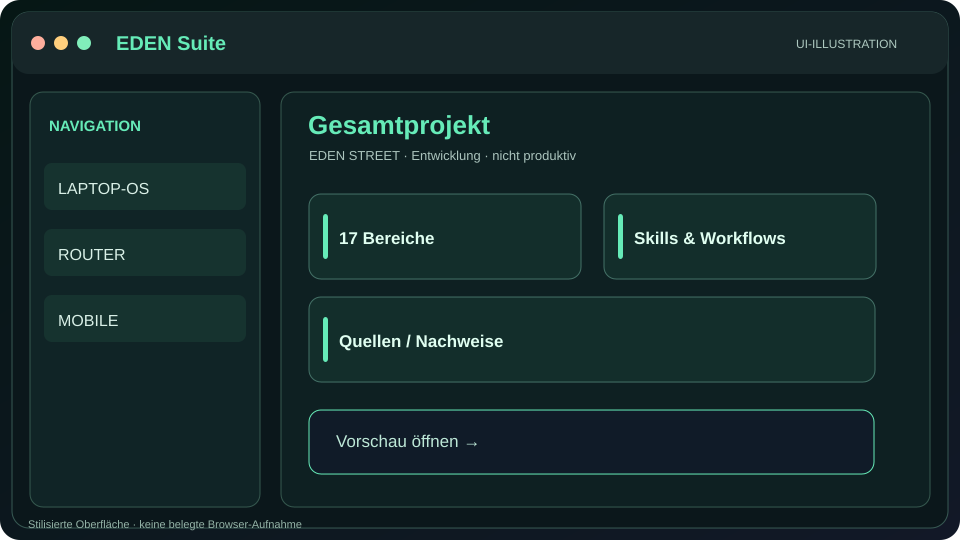](suite/README.md) | **EDEN Suite** | Systemüberblick · [Anleitung](suite/README.md) · [llms.txt](suite/llms.txt) |
| [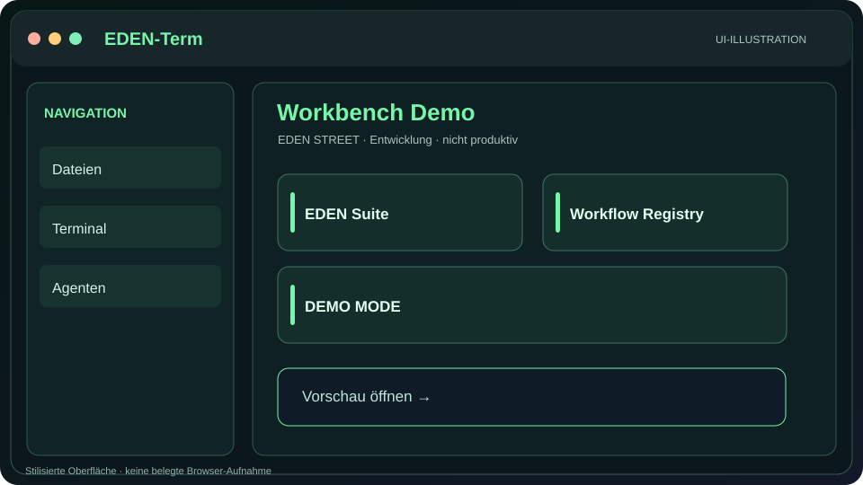](terminal/README.md) | **EDEN-Term** | Workbench · [Anleitung](terminal/README.md) · [llms.txt](terminal/llms.txt) |
| [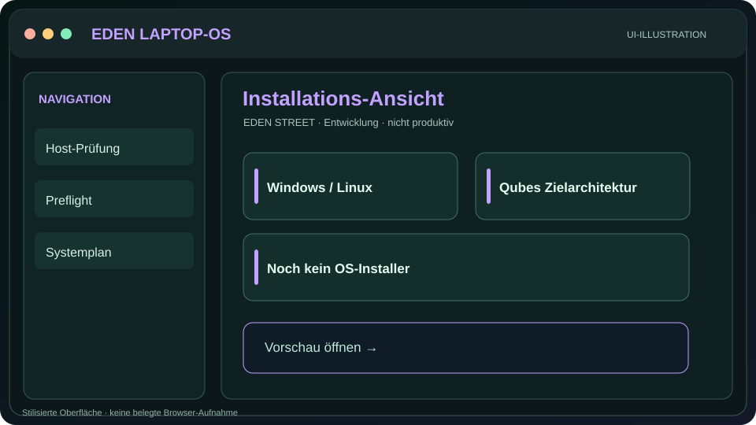](laptop/README.md) | **LAPTOP-OS** | Installation / Preflight · [Anleitung](laptop/README.md) · [llms.txt](laptop/llms.txt) |
| [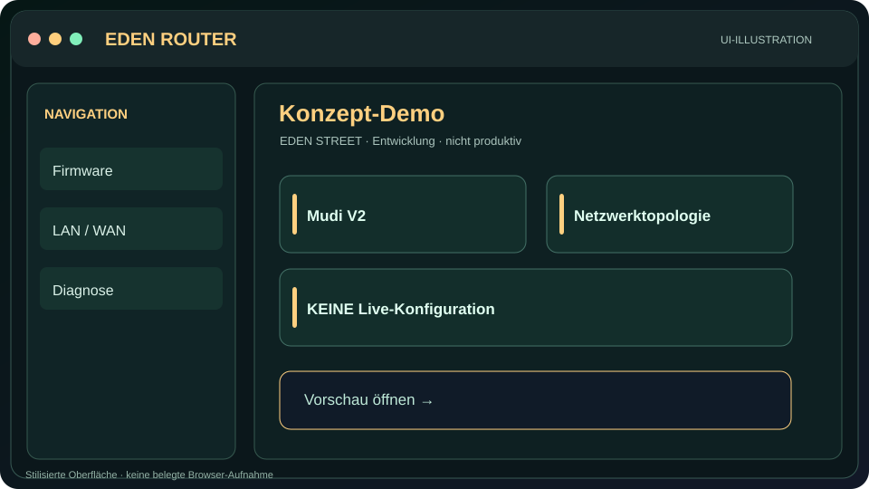](router/README.md) | **ROUTER** | Netzwerk-Konzept · [Anleitung](router/README.md) · [llms.txt](router/llms.txt) |
| [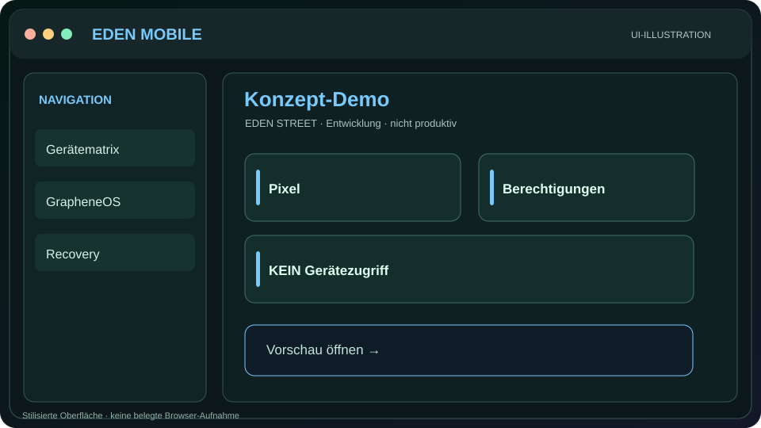](mobile/README.md) | **MOBILE** | GrapheneOS-Konzept · [Anleitung](mobile/README.md) · [llms.txt](mobile/llms.txt) |
| [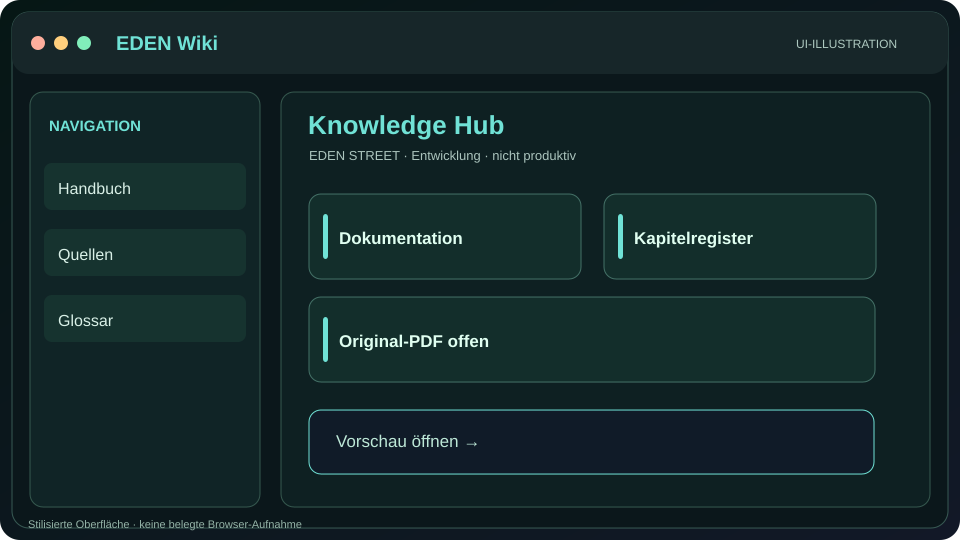](wiki/README.md) | **Wiki** | Wissenshub · [Anleitung](wiki/README.md) · [llms.txt](wiki/llms.txt) |
| [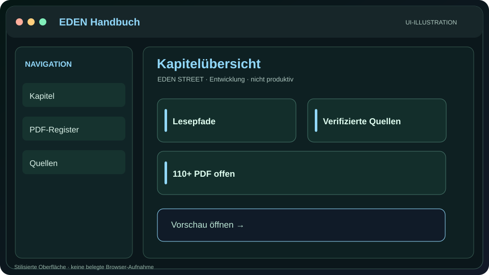](handbuch/README.md) | **Handbuch** | Dokumentation / PDF · [Anleitung](handbuch/README.md) · [llms.txt](handbuch/llms.txt) |
| [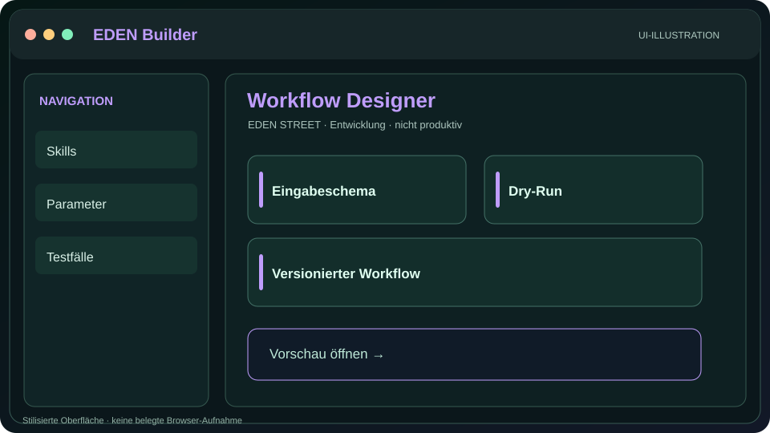](builder/README.md) | **Builder** | Skill- und Workflow-Entwürfe · [Anleitung](builder/README.md) · [llms.txt](builder/llms.txt) |
| [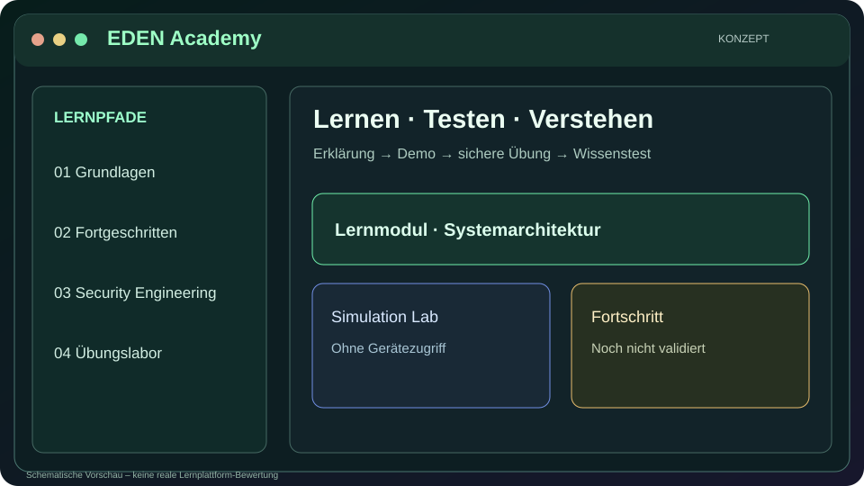](academy/README.md) | **Academy** | Training · [Anleitung](academy/README.md) · [llms.txt](academy/llms.txt) |
| [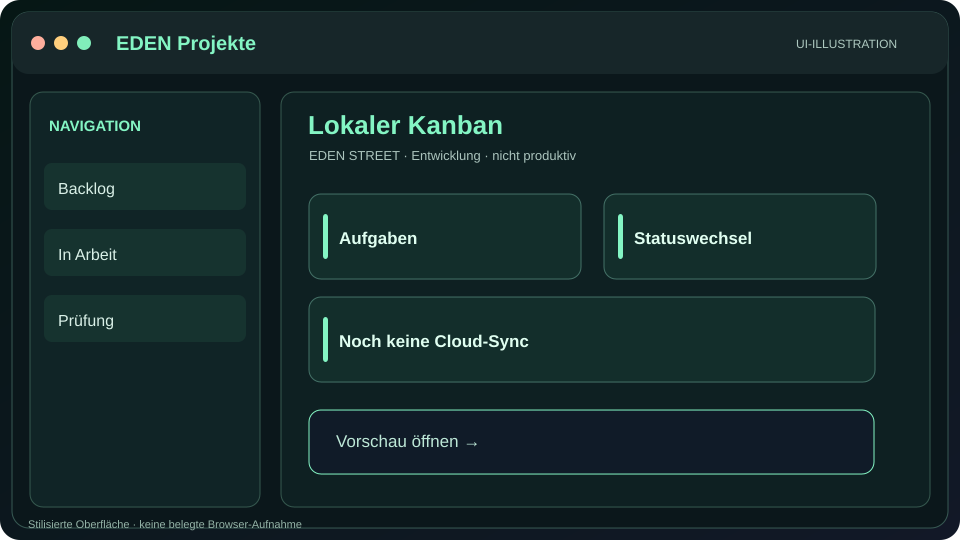](projects/README.md) | **Projekte / Kanban** | Projektmanagement · [Anleitung](projects/README.md) · [llms.txt](projects/llms.txt) |
| [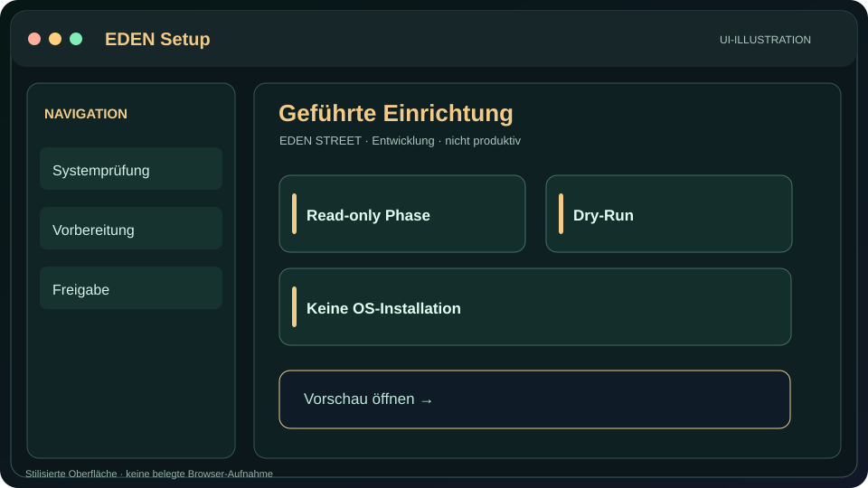](setup/README.md) | **Setup** | Geführte Einrichtung · [Anleitung](setup/README.md) · [llms.txt](setup/llms.txt) |
| [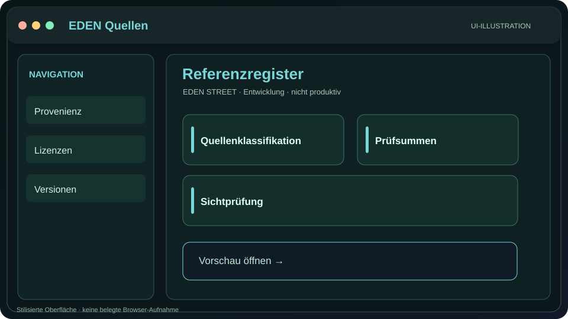](quellen/README.md) | **Quellen** | Provenienz · [Anleitung](quellen/README.md) · [llms.txt](quellen/llms.txt) |
| [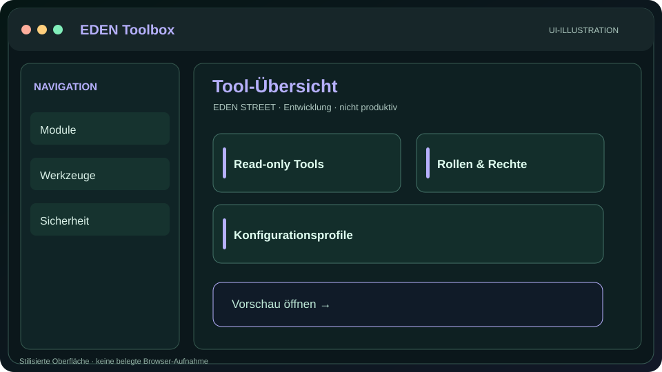](toolbox/README.md) | **Toolbox** | Werkzeuge · [Anleitung](toolbox/README.md) · [llms.txt](toolbox/llms.txt) |
| [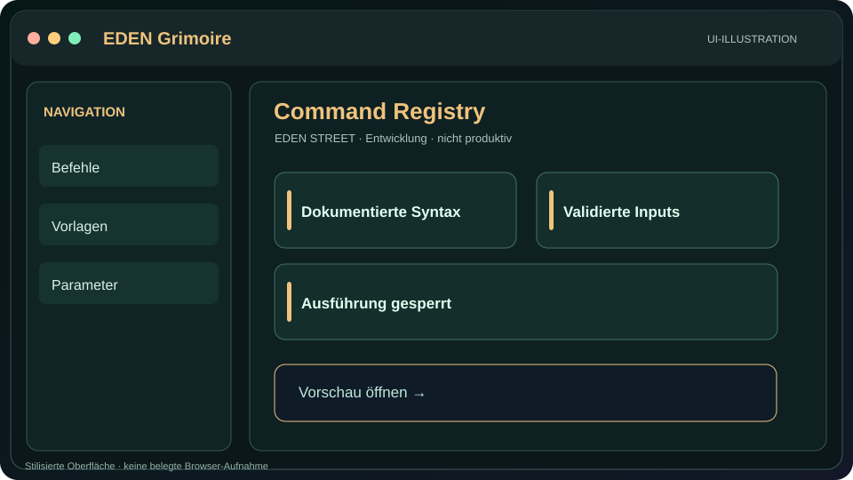](grimoire/README.md) | **Grimoire** | Command Registry · [Anleitung](grimoire/README.md) · [llms.txt](grimoire/llms.txt) |
| [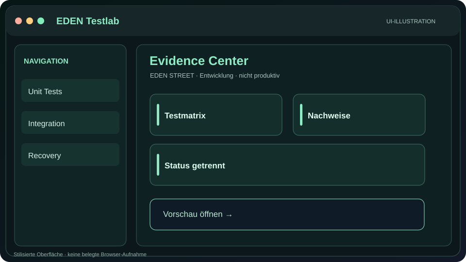](testlab/README.md) | **Testlab** | Nachweise · [Anleitung](testlab/README.md) · [llms.txt](testlab/llms.txt) |

## Einheitliches Verhalten
- Die Oberfläche erklärt ihre eigene Version, Datenklasse, Test- und Freigabegrenze.
- Der Arbeitsablauf ist in einem eigenen Prompt dokumentiert.
- Die Vorschau ist **nicht** mit einem Betriebssystem, einer Router-Firmware oder einem Smartphone verbunden.
- Echte Entwicklungsänderungen erfordern Branch, Diff, Tests, Review und Rollback.

## Visuelle Workflow-Galerie

[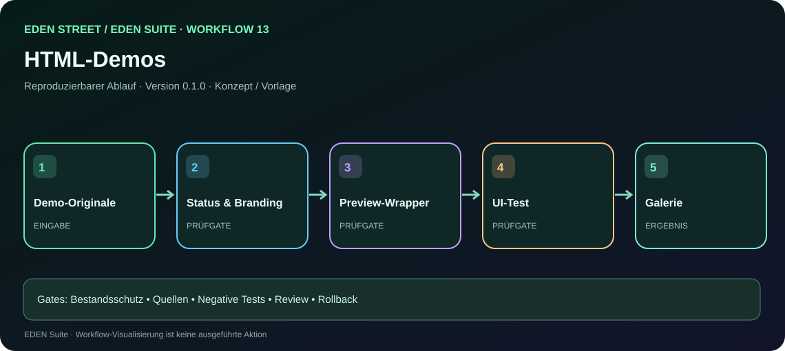](../workflow.html?id=13)

[Alle 17 Schrittansichten öffnen](../workflows.html)
