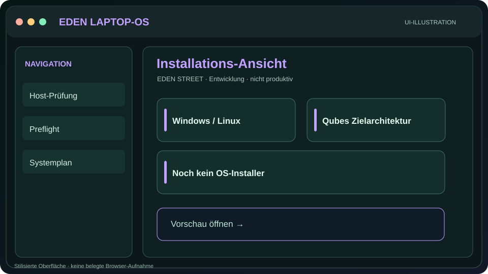
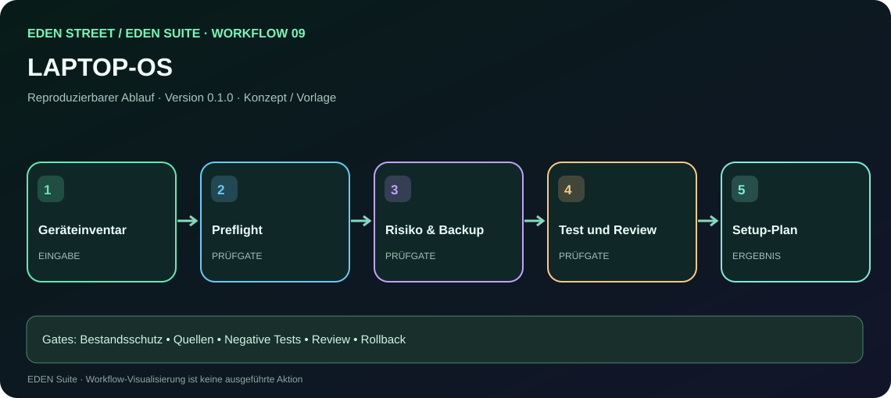

# EDEN LAPTOP-OS — Oberfläche, Vorschau und Arbeitsanleitung

[← Gesamtprojekt](../../index.html) · [Alle Oberflächen](../README.md) · [Alle Workflows](../../workflows.html) · [Assistenten-Anweisungen](llms.txt)

**Zustand:** vorhandene historische HTML-Demo oder dokumentierte Oberfläche · **Keine reale Geräteaktion.**

## Visuelle Vorschau

**[HTML-Vorschau öffnen](../../preview.html?surface=setup)**

Das Bild ist eine SVG-Illustration, kein echter Browser-Screenshot. GitHub-HTML-Quellseiten werden erst nach erfolgreicher Webbereitstellung interaktiv ausgeführt.

## Umfang
Read-only Preflight, vorhandener Starter und kontrollierte Installationsplanung.

## Zugeordneter Workflow

[**Workflow 09 interaktiv durchgehen**](../../workflow.html?id=09) · [Prompt und Bedienungsanleitung](../../prompts/09-laptop.md)

## Arbeitsschritte
1. Bestehende HTML-/Projektdateien und ihren Git-Stand überprüfen.
2. Historische Designentscheidungen, Quellen und Links bewahren.
3. Fehlende Bedienung und Statushinweise additiv ergänzen.
4. Demo-Zustände ausdrücklich von echter Implementierung trennen.
5. UI, Tastaturbedienung, Responsive-Ansicht, Links und Sicherheit testen.
6. Version, Branch, Testbeleg, Diff, Rollback und Review dokumentieren.

## Maschinenlesbare Arbeitsanweisung
[llms.txt für diese Oberfläche](llms.txt)

## Aktueller LAPTOP-OS-Softwarestand (2026-11-04)

Die frühere Portal-Illustration bleibt eine **Konzept-Vorschau**. Die eigenständige lokale npm-App hat inzwischen einen getrennt geprüften, funktionsfähigen Stand **`v0.8.0-preview.8`**:

- [LAPTOP-OS Quellcode und npm-Ein-Kommando-Start](https://github.com/EDEN-STREET/LAPTOP-OS)
- [Read-only Gate-5- und Reboot-Dokumentation](https://github.com/EDEN-STREET/LAPTOP-OS/blob/main/docs/REBOOT-TO-INSTALLER-WORKFLOW.md)
- [Vollständigkeits-/Integritäts-Fix der Browser-App, PR #20](https://github.com/EDEN-STREET/LAPTOP-OS/pull/20)
- [Übergreifender Zweit-Audit über vier Repositories](../../EDEN-CROSS-REPO-AUDIT-2026-11-04.md)

Tests für die eigenständige App: **70/70 Node-Tests** unter Windows und Linux; 13 HTML-Seiten auf Desktop und 390-px-Mobile, 30 PNG-Screenshots, CodeQL und npm-Paketprüfung auf dem Audit-PR. **Diese Tests betreffen die lokale npm-App, nicht automatisch das hier veröffentlichte Portal.**

Windows, Qubes/Tails-Installation, Tor-Kill-Switch und Hardwareeignung sind weiterhin **nicht** freigegeben oder geräteseitig nachgewiesen.

## Abnahmestatus
- Vorschauillustration: **vorhanden**
- HTML-Vorschau-Datei: **im Repository vorhanden**; Hosting nicht verifiziert
- Echte Geräteverbindung: **nein**
- Browser-End-to-End-Test: **Portal-Laptop-Skizze nicht mit der getrennt getesteten npm-App verwechseln; App-Testnachweise siehe oben**
- Vollständige Produktfreigabe: **nein**
