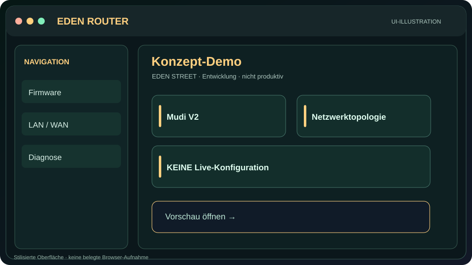
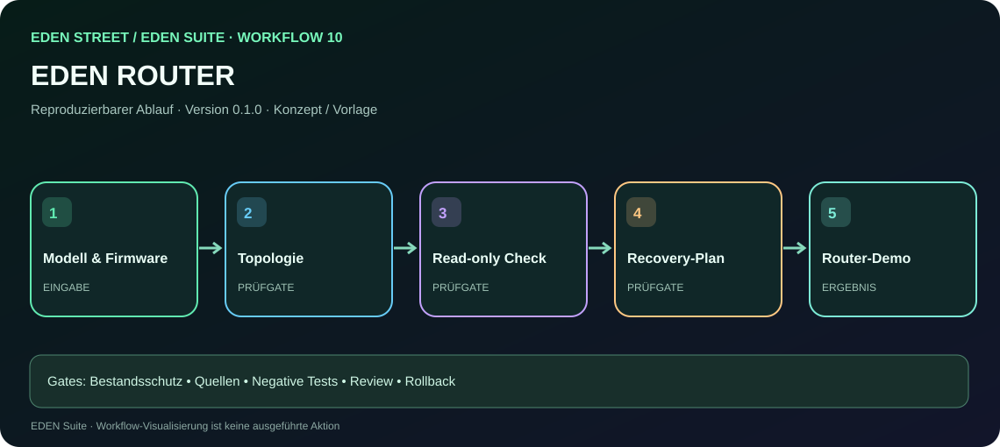

# EDEN ROUTER — Oberfläche, Vorschau und Arbeitsanleitung

**[Eigenständiges öffentliches EDEN ROUTER Repository](https://github.com/EDEN-STREET/ROUTER)** · [Suite Portal](../../index.html)

[← Gesamtprojekt](../../index.html) · [Alle Oberflächen](../README.md) · [Alle Workflows](../../workflows.html) · [Assistenten-Anweisungen](llms.txt)

**Zustand:** KONZEPT / interaktive Simulation · **Keine reale Geräteaktion.**

## Visuelle Vorschau

**[HTML-Vorschau öffnen](../../preview.html?surface=router)**

Das Bild ist eine SVG-Illustration, kein echter Browser-Screenshot. GitHub-HTML-Quellseiten werden erst nach erfolgreicher Webbereitstellung interaktiv ausgeführt.

## Umfang
Mudi-V2-Netzwerkplanung, Modell-/Firmware-Matrix, Backup, Recovery.

## Zugeordneter Workflow

[**Workflow 10 interaktiv durchgehen**](../../workflow.html?id=10) · [Prompt und Bedienungsanleitung](../../prompts/10-router.md)

## Arbeitsschritte
1. Bestehende HTML-/Projektdateien und ihren Git-Stand überprüfen.
2. Historische Designentscheidungen, Quellen und Links bewahren.
3. Fehlende Bedienung und Statushinweise additiv ergänzen.
4. Demo-Zustände ausdrücklich von echter Implementierung trennen.
5. UI, Tastaturbedienung, Responsive-Ansicht, Links und Sicherheit testen.
6. Version, Branch, Testbeleg, Diff, Rollback und Review dokumentieren.

## Maschinenlesbare Arbeitsanweisung
[llms.txt für diese Oberfläche](llms.txt)

## Abnahmestatus
- Vorschauillustration: **vorhanden**
- HTML-Vorschau-Datei: **im Repository vorhanden**; Hosting nicht verifiziert
- Echte Geräteverbindung: **nein**
- Browser-End-to-End-Test: **noch nicht als bestanden bestätigt**
- Vollständige Produktfreigabe: **nein**
