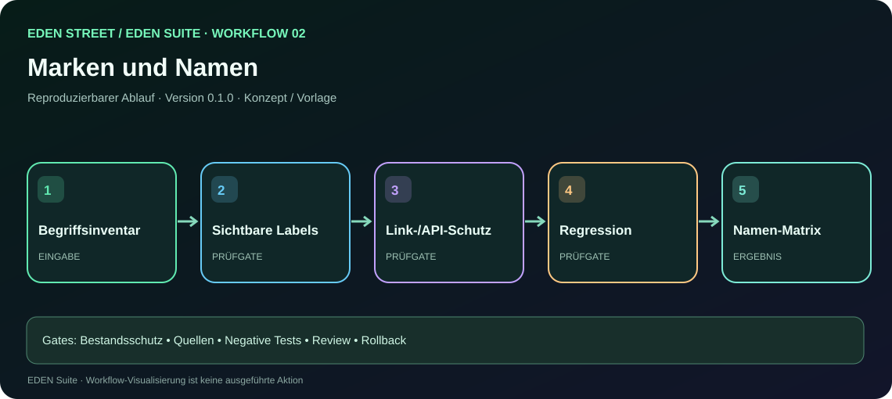

# EDEN Suite · Arbeitsauftrag 02: Marken, Namen und Migration

**[Interaktive Schritt-für-Schritt-Demo öffnen](../workflow.html?id=02)** · Die Darstellung ist eine simulierte Prozessansicht, kein tatsächlich ausgeführter Workflow.

**Typ:** wiederverwendbarer Aufgabenprompt + Workflow · **Version:** 0.1.0 · **Status:** dokumentiertes Arbeitsmuster

## Prompt zur Weitergabe
> Du bearbeitest ausschließlich den EDEN STREET/EDEN Suite-Bereich **Marken, Namen und Migration**. Arbeite additiv und mit Bestandsschutz. Lies den aktuellen GitHub-HEAD sowie vorhandene lokale Änderungen, bevor du Code änderst. Gib zuerst die Quellen, den aktuellen Status und den geplanten Diff an. Verschiebe keine fremden Änderungen und verwende keine älteren Dateien als ungeprüfte neue Referenz. Starte mit einem nicht-destruktiven Prüfplan.

**Umgebung:** `<REPO>` · **Basisrevision:** `<BASE_SHA>` · **Arbeitsbranch:** `<BRANCH>` · **Nachweise:** `<EVIDENCE_DIR>`.

## Zuständige Agentenrollen
- **Discovery**
- **UI Editor**
- **Verifier**

## Workflow 02
1. Sichtbare alte Begriffe in öffentlichen Seiten inventarisieren.
2. EDEN STREET / EDEN Suite / EDEN-Term vereinheitlichen.
3. Interne IDs, Links und APIs unverändert lassen oder Migration planen.
4. Entwurfsdateien und Dokumentation im Feature-Branch ergänzen, nicht blind überschreiben.
5. Passende positive und negative Tests, Link-/Schema-/Sichtprüfung durchführen.
6. Testbelege, Diff, Risiken, Rollback und offene Fragen für Review bereitstellen.

## Erforderliche Eingaben
- Tatsächlicher Repo-HEAD, vorhandene Dateien und aktuelle Issue-/PR-Bezüge
- Relevante historische Quellen und Datenschutzklasse
- Definition of Done, Zielgruppe und unterstützte Varianten

## Erwartetes Ergebnis
**Namen-Matrix und getestete Links.** Zusätzlich: Änderungsprotokoll, Versionsnummer, reproduzierbare Befehle (nur validierte), Nachweis-ID und offene Risiken.

## Qualitätsgates
- G0: Quellen/Herkunft vorhanden
- G1: Bestehende Funktion und Historie erhalten
- G2: Kein Datenleck oder Rechteüberschreitung
- G3: Positiv- und Negativtests dokumentiert
- G4: Nutzeroberfläche/Links/Barrierefreiheit bewertet (wo anwendbar)
- G5: Review- und Rollbackfähigkeit gegeben

**Besonderes Stoppsignal:** Keine massenhafte Code-Umbenennung.

## Benutzung
1. Öffne die zugehörige GitHub-Projektübersicht und lies die Ausgangsdokumente.
2. Kopiere **nur diesen** Prompt in deine Entwicklungsumgebung.
3. Ersetze die Platzhalter `<BASE_SHA>`, `<BRANCH>`, `<EVIDENCE_DIR>` durch tatsächlich ermittelte Angaben.
4. Führe zunächst ausschließlich Bestandsaufnahme und Dry-Run aus.
5. Lege einen nachvollziehbaren Diff, Testergebnisse und eine Rollback-Notiz vor.

**Statusdisziplin:** KONZEPT, DEMO, IMPLEMENTIERT, CI-GEPRÜFT, HARDWARE-GEPRÜFT und FREIGEGEBEN sind unterschiedliche Zustände.

**Freigaberegel:** Keine unautorisierten Änderungen an Betriebssystem, Firmware, Netzwerkinfrastruktur, Partitionierung oder Zugriffsrechten. Keine Secrets und privaten Originale in öffentliche Repositories.

## Verknüpfungen
[Masterdokumentation](../EDEN-STREET-MASTERDOKUMENTATION.md) · [Agentenrollen](../AGENTEN-UND-WORKFLOWS.md) · [Demoportal](../index.html)
