# EDEN Suite · 17 eigenständige Prompts und Workflows

**Version 0.1.0 · einzeln ausführbar · immer mit Bestandsschutz**

[Jede Aufgabe besitzt einen eigenen Prompt, Agentenrollen, Arbeitsschritte, Testgates und Ergebnisvertrag.](../EDEN-STREET-MASTERDOKUMENTATION.md)

## Alle 17 Bereiche mit Vorschau

Die Miniaturen sind **prozessbezogene SVG-Illustrationen**. Ein Klick auf die Grafik führt zur Schritt-für-Schritt-Demo; für öffentliche Bedienung muss das HTML über einen Webhost (z. B. GitHub Pages) ausgeliefert werden.

| Vorschau | Bereich | Prompt und Bedienungsanweisung |
|---|---|---|
|  | **01 – Strategie** · [interaktive Ansicht](../workflow.html?id=01) | [Arbeitsauftrag 01](01-strategy.md) |
| [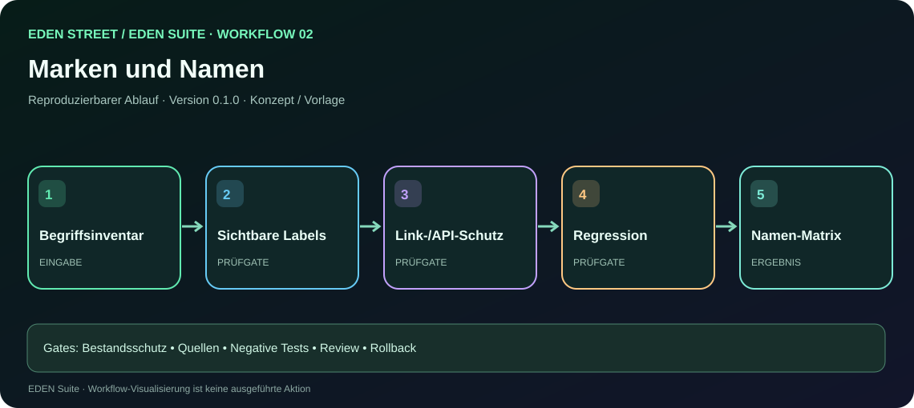](../workflow.html?id=02) | **02 – Namen & Migration** · [interaktive Ansicht](../workflow.html?id=02) | [Arbeitsauftrag 02](02-brand.md) |
| [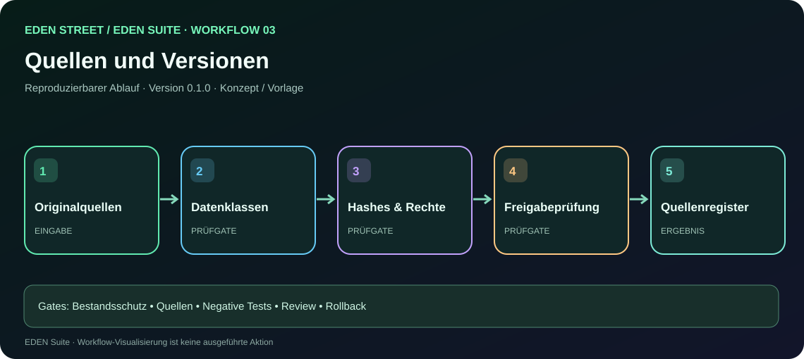](../workflow.html?id=03) | **03 – Quellen und Provenienz** · [interaktive Ansicht](../workflow.html?id=03) | [Arbeitsauftrag 03](03-provenance.md) |
| [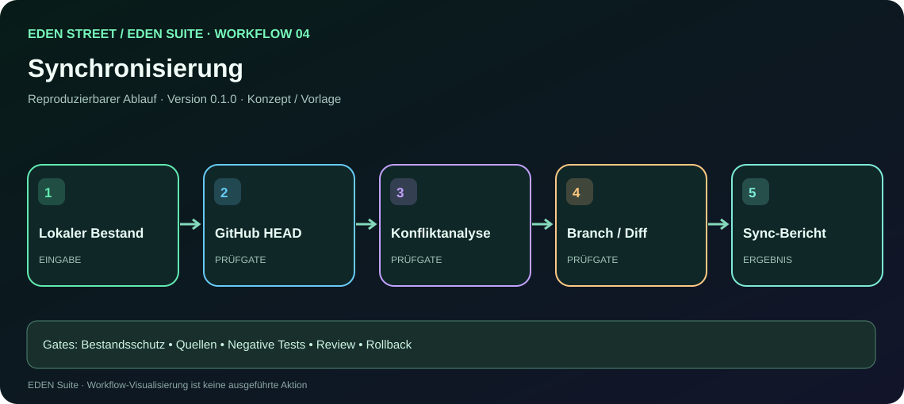](../workflow.html?id=04) | **04 – GitHub-/Lokal-Sync** · [interaktive Ansicht](../workflow.html?id=04) | [Arbeitsauftrag 04](04-sync.md) |
| [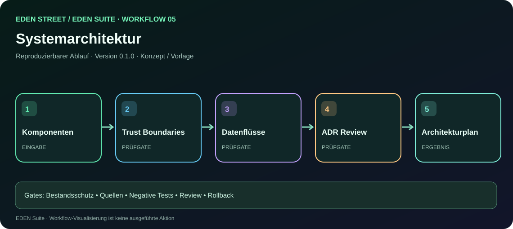](../workflow.html?id=05) | **05 – Systemarchitektur** · [interaktive Ansicht](../workflow.html?id=05) | [Arbeitsauftrag 05](05-architecture.md) |
| [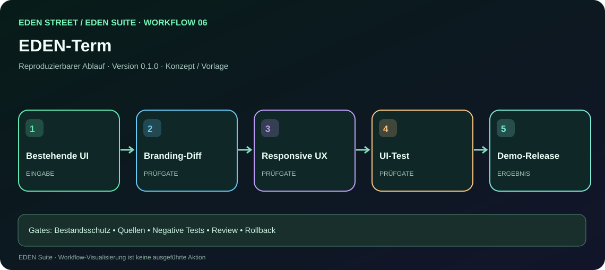](../workflow.html?id=06) | **06 – EDEN-Term** · [interaktive Ansicht](../workflow.html?id=06) | [Arbeitsauftrag 06](06-terminal.md) |
| [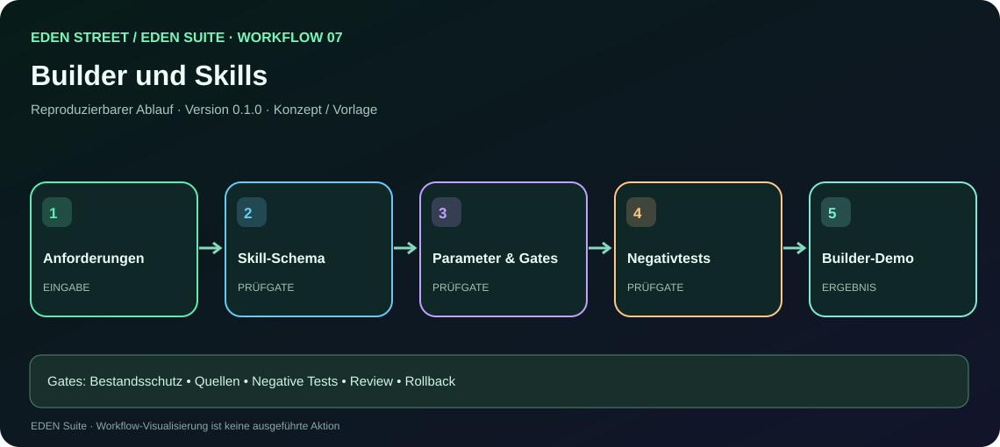](../workflow.html?id=07) | **07 – Builder und Skills** · [interaktive Ansicht](../workflow.html?id=07) | [Arbeitsauftrag 07](07-builder.md) |
|  | **08 – Wiki, Handbuch, PDF** · [interaktive Ansicht](../workflow.html?id=08) | [Arbeitsauftrag 08](08-knowledge.md) |
| [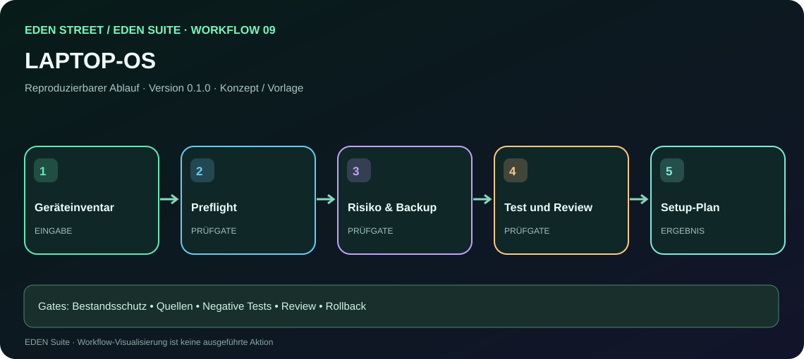](../workflow.html?id=09) | **09 – LAPTOP-OS** · [interaktive Ansicht](../workflow.html?id=09) | [Arbeitsauftrag 09](09-laptop.md) |
| [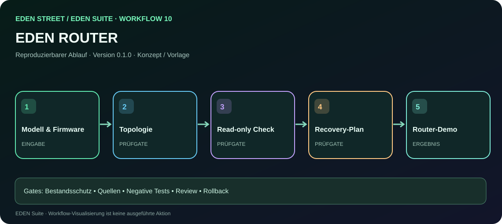](../workflow.html?id=10) | **10 – ROUTER** · [interaktive Ansicht](../workflow.html?id=10) | [Arbeitsauftrag 10](10-router.md) |
| [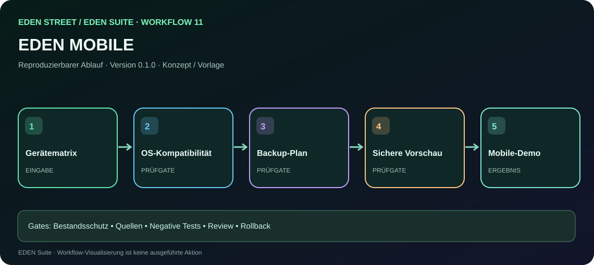](../workflow.html?id=11) | **11 – MOBILE** · [interaktive Ansicht](../workflow.html?id=11) | [Arbeitsauftrag 11](11-mobile.md) |
| [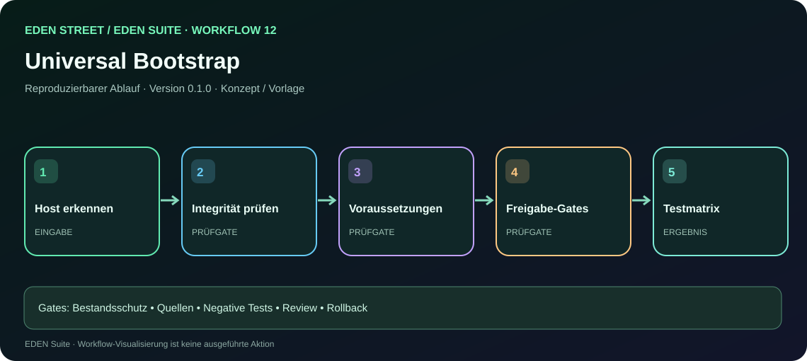](../workflow.html?id=12) | **12 – Universal Bootstrap** · [interaktive Ansicht](../workflow.html?id=12) | [Arbeitsauftrag 12](12-bootstrap.md) |
| [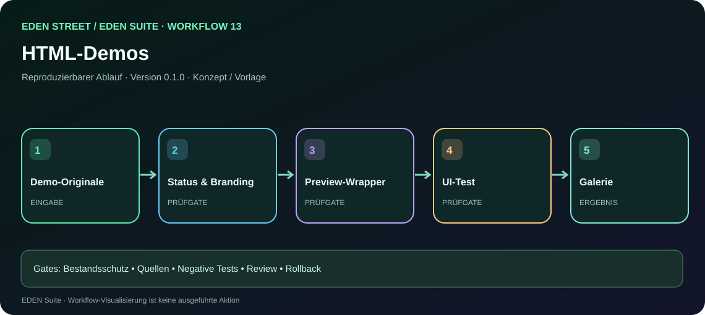](../workflow.html?id=13) | **13 – HTML-Demos** · [interaktive Ansicht](../workflow.html?id=13) | [Arbeitsauftrag 13](13-previews.md) |
| [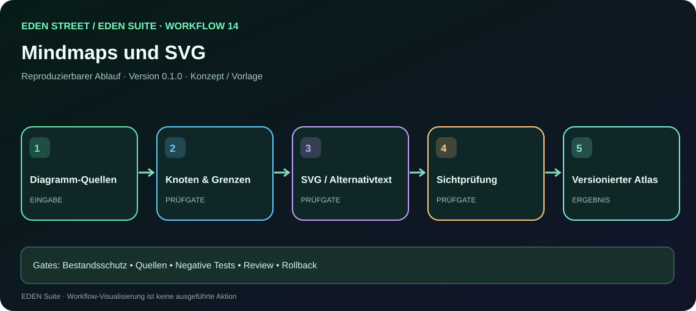](../workflow.html?id=14) | **14 – Mindmaps und Diagramme** · [interaktive Ansicht](../workflow.html?id=14) | [Arbeitsauftrag 14](14-visuals.md) |
|  | **15 – Test und Security** · [interaktive Ansicht](../workflow.html?id=15) | [Arbeitsauftrag 15](15-quality.md) |
| [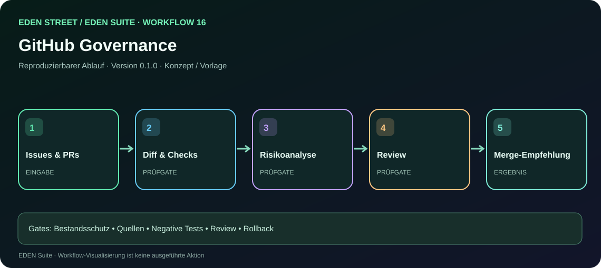](../workflow.html?id=16) | **16 – GitHub Governance** · [interaktive Ansicht](../workflow.html?id=16) | [Arbeitsauftrag 16](16-github.md) |
| [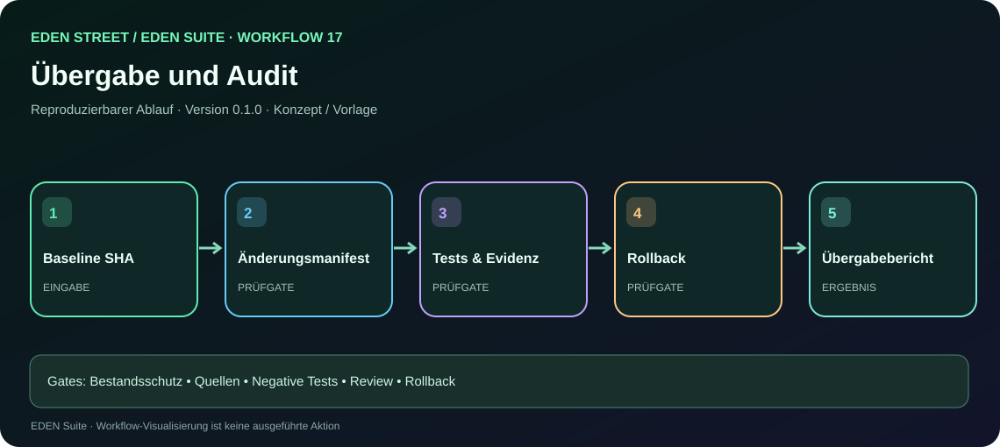](../workflow.html?id=17) | **17 – Übergabe und Audit** · [interaktive Ansicht](../workflow.html?id=17) | [Arbeitsauftrag 17](17-handoff.md) |

[Alle visuellen Workflows in der Galerie](../workflows.html) · [Agenten und Freigaben](../AGENTEN-UND-WORKFLOWS.md)

| Nr. | Bereich | Arbeitsauftrag |
|---|---|---|
| 01 | Strategie | [Prompt & Workflow 01](01-strategy.md) |
| 02 | Naming | [Prompt & Workflow 02](02-brand.md) |
| 03 | Provenienz | [Prompt & Workflow 03](03-provenance.md) |
| 04 | Synchronisation | [Prompt & Workflow 04](04-sync.md) |
| 05 | Architektur | [Prompt & Workflow 05](05-architecture.md) |
| 06 | EDEN-Term | [Prompt & Workflow 06](06-terminal.md) |
| 07 | Builder | [Prompt & Workflow 07](07-builder.md) |
| 08 | Wiki & PDF | [Prompt & Workflow 08](08-knowledge.md) |
| 09 | Laptop | [Prompt & Workflow 09](09-laptop.md) |
| 10 | Router | [Prompt & Workflow 10](10-router.md) |
| 11 | Mobile | [Prompt & Workflow 11](11-mobile.md) |
| 12 | Bootstrap | [Prompt & Workflow 12](12-bootstrap.md) |
| 13 | Demos | [Prompt & Workflow 13](13-previews.md) |
| 14 | Mindmaps | [Prompt & Workflow 14](14-visuals.md) |
| 15 | Qualität | [Prompt & Workflow 15](15-quality.md) |
| 16 | GitHub | [Prompt & Workflow 16](16-github.md) |
| 17 | Übergabe | [Prompt & Workflow 17](17-handoff.md) |

## Bedienungsanweisung

1. **Bereich auswählen.** Pro Änderung nur die thematisch passende Datei als primären Auftrag nutzen; Abhängigkeiten explizit verlinken.
2. **GitHub-Stand abgleichen.** Tatsächlichen `main`-HEAD, bestehende Branches und lokale Dateien prüfen. Keine alten Commits blind als neuen Ausgangspunkt einsetzen.
3. **Plan berichten.** Quellen, Ausgangsbasis, gewünschte Änderung, Tests, Risiken und betroffene Dateien angeben.
4. **Sicher umsetzen.** Feature-Branch, kleine Commits, Versionsnummer; bei Konflikten stoppen und Rückfragen formulieren.
5. **Verifizieren.** Negativtests, Testreport, Diff, Screenshots nur nach realem Rendern, Rollback.
6. **Review.** Keine automatische Freigabe oder destruktive Geräteaktion.

## Agenten- und Workflow-Verzeichnis

[Agentenrollen, Verantwortlichkeiten, Freigabegrenzen und Workflow-Verkettung](../AGENTEN-UND-WORKFLOWS.md)

Die Prompts sind Arbeitsmuster, **keine bereits ausgeführten Workflows**. Sie ändern keine Geräte und behaupten keine erfolgreichen CI-Läufe.
