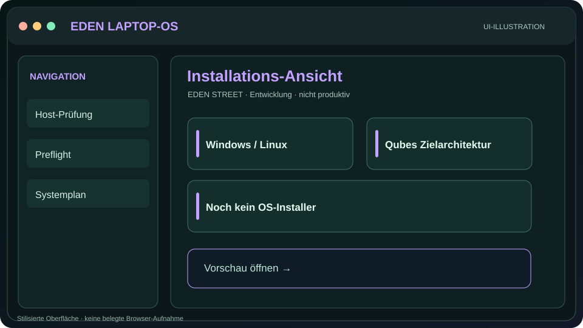
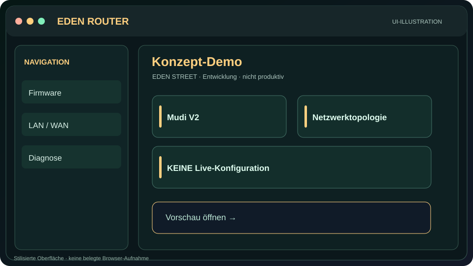
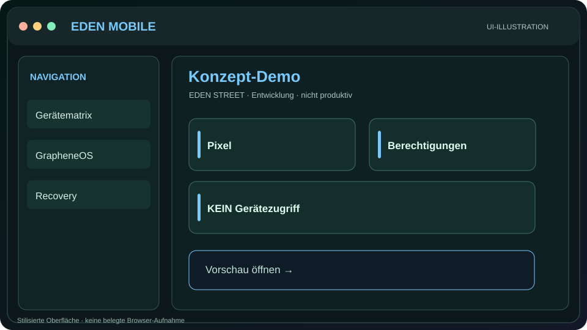
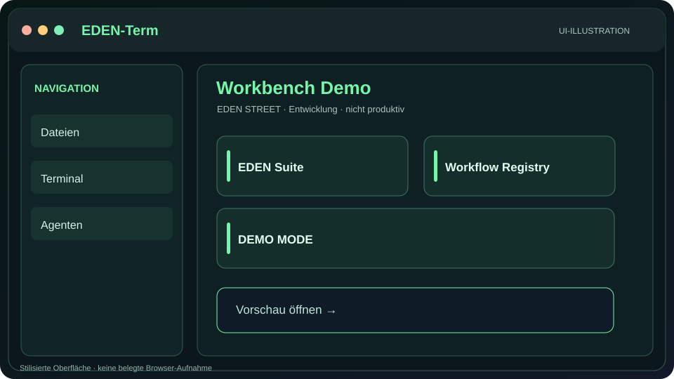
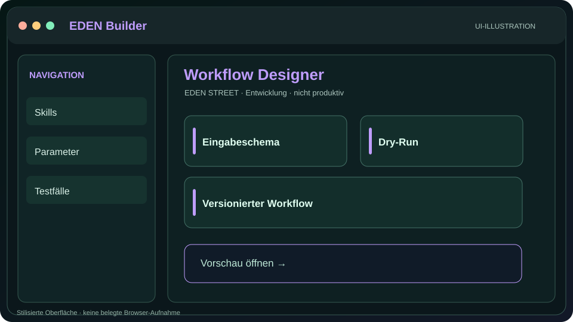
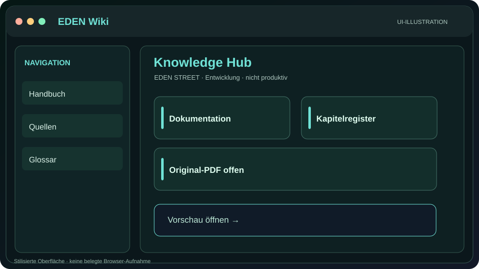
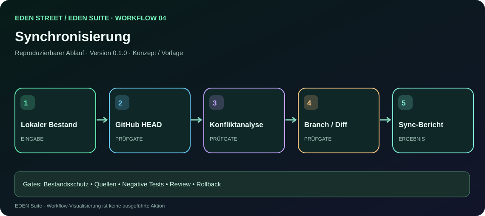
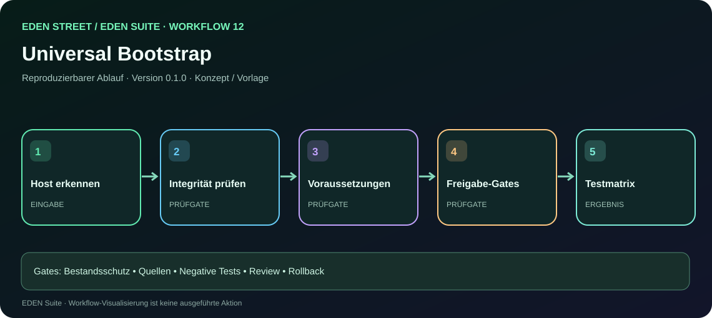
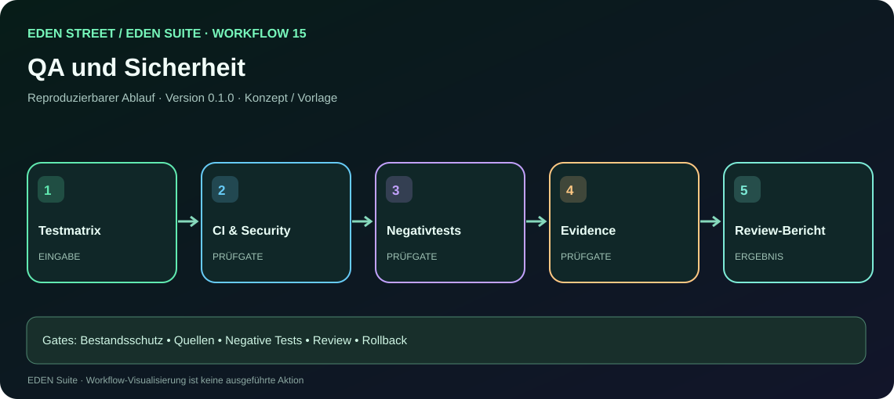
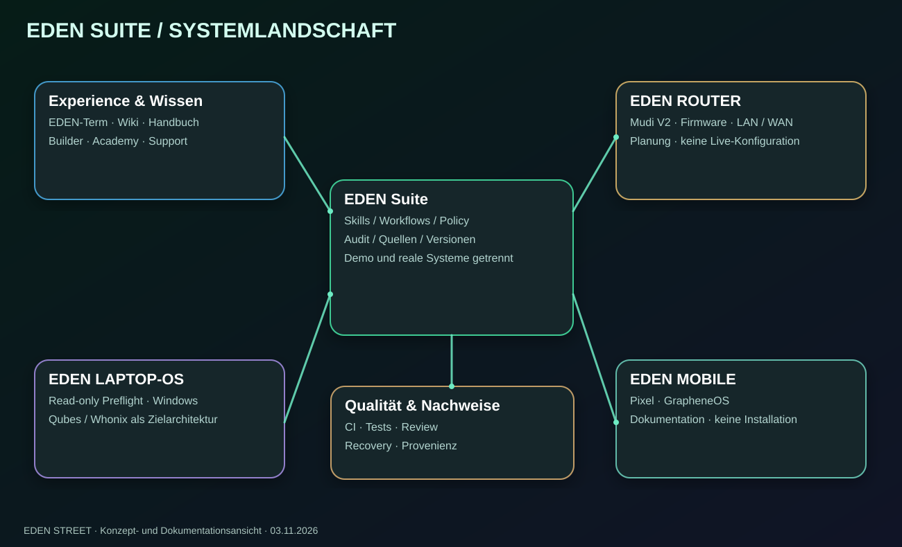

# 🌿 EDEN STREET — EDEN Suite

**Modulare, nachvollziehbar entwickelte Plattform für Geräteeinrichtung, Automatisierung, Wissensmanagement und Sicherheit.**

> **Projektstatus: Entwicklung und Demo.** Installationen, Router- oder Smartphoneänderungen werden durch diese Vorschauen **nicht** durchgeführt. Jede reale technische Prüfung und jede Freigabe ist gesondert nachzuweisen.

### 🧭 Navigation

| 📁 Repositories | 📘 Dokumentation | 📚 Wiki | 🖥️ Demos | 🔁 Workflows | 🗺️ Mindmaps |
|---|---|---|---|---|---|
| [Alle Projekte](https://github.com/EDEN-STREET?tab=repositories) | [17 Bereiche](https://github.com/EDEN-STREET/.github/blob/main/docs/EDEN-STREET-MASTERDOKUMENTATION.md) | [Wiki-Portal](https://github.com/EDEN-STREET/.github/blob/main/docs/WIKI.md) | [Vorschaubilder](https://github.com/EDEN-STREET/.github/blob/main/docs/EDEN-DEMO-GALERIE.md) | [17 visuelle Abläufe](https://github.com/EDEN-STREET/.github/blob/main/docs/workflows.html) | [Strukturatlas](https://github.com/EDEN-STREET/.github/blob/main/docs/EDEN-ASCII-ATLAS.md) |
| [LAPTOP-OS](https://github.com/EDEN-STREET/LAPTOP-OS) · [ROUTER](https://github.com/EDEN-STREET/ROUTER) · [MOBILE](https://github.com/EDEN-STREET/MOBILE) | [Prompt-/Skill-Katalog](https://github.com/EDEN-STREET/.github/blob/main/docs/prompts/README.md) | [PDF-Status](https://github.com/EDEN-STREET/.github/blob/main/docs/EDEN-DOKUMENTATIONSREGISTER.md) | [HTML-Portal-Quelle](https://github.com/EDEN-STREET/.github/blob/main/docs/index.html) | [Agenten & Rollen](https://github.com/EDEN-STREET/.github/blob/main/docs/AGENTEN-UND-WORKFLOWS.md) | [SVG-Quellen](https://github.com/EDEN-STREET/.github/blob/main/docs/media/EDEN-SUITE-SYSTEMLANDSCHAFT.svg) |

### 🖥️ Projektvorschauen

**Die Bilder sind skalierbare, beschriftete Illustrationen und keine echten Browser-Screenshots.** GitHub Pages ist laut [erfolgreichem Deployment](https://github.com/EDEN-STREET/.github/actions/runs/41690248279) eingerichtet; Quelltextlinks starten keine Live-App. Unabhängige Browser-Abnahme erfolgt separat.

| LAPTOP-OS | ROUTER | MOBILE |
|---|---|---|
| [](https://github.com/EDEN-STREET/.github/blob/main/docs/preview.html) | [](https://github.com/EDEN-STREET/.github/blob/main/docs/preview.html) | [](https://github.com/EDEN-STREET/.github/blob/main/docs/preview.html) |
| [Repository](https://github.com/EDEN-STREET/LAPTOP-OS) · [Live-Vorschau](https://eden-street.github.io/.github/preview.html?surface=terminal) · [UI-Quellansicht](https://github.com/EDEN-STREET/.github/blob/main/docs/preview.html) | [Repository](https://github.com/EDEN-STREET/ROUTER) · [Live-Vorschau](https://eden-street.github.io/.github/preview.html?surface=router) · [Planungsstand](https://github.com/EDEN-STREET/.github/blob/main/docs/projects/ROUTER.md) · [Konzept-Demo-Quelle](https://github.com/EDEN-STREET/.github/blob/main/docs/concept-demo.html) | [Repository](https://github.com/EDEN-STREET/MOBILE) · [Live-Vorschau](https://eden-street.github.io/.github/preview.html?surface=mobile) · [Planungsstand](https://github.com/EDEN-STREET/.github/blob/main/docs/projects/MOBILE.md) · [Konzept-Demo-Quelle](https://github.com/EDEN-STREET/.github/blob/main/docs/concept-demo.html) |

| EDEN-Term | Builder | Wiki |
|---|---|---|
| [](https://github.com/EDEN-STREET/.github/blob/main/docs/preview.html) | [](https://github.com/EDEN-STREET/.github/blob/main/docs/preview.html) | [](https://github.com/EDEN-STREET/.github/blob/main/docs/preview.html) |
| [Workbench Demo-Quelle](https://github.com/EDEN-STREET/.github/blob/main/docs/legacy/index.html) | [Builder Demo-Quelle](https://github.com/EDEN-STREET/.github/blob/main/docs/legacy/builder.html) | [Wiki Demo-Quelle](https://github.com/EDEN-STREET/.github/blob/main/docs/legacy/wiki.html) |

### 🔁 Workflow- und Installationsansichten

| Bestand synchronisieren | Universal Setup | Qualitätsprüfung |
|---|---|---|
| [](https://github.com/EDEN-STREET/.github/blob/main/docs/workflow.html) | [](https://github.com/EDEN-STREET/.github/blob/main/docs/workflow.html) | [](https://github.com/EDEN-STREET/.github/blob/main/docs/workflow.html) |
| [Arbeitsauftrag 04](https://github.com/EDEN-STREET/.github/blob/main/docs/prompts/04-sync.md) | [Arbeitsauftrag 12](https://github.com/EDEN-STREET/.github/blob/main/docs/prompts/12-bootstrap.md) | [Arbeitsauftrag 15](https://github.com/EDEN-STREET/.github/blob/main/docs/prompts/15-quality.md) |

**[Öffentliches EDEN Suite Portal](https://eden-street.github.io/.github/)** · **[Statischer QA-Bericht: 17 Workflows, 37 SVG, 739 Links](https://github.com/EDEN-STREET/.github/blob/main/docs/VALIDIERUNGSBERICHT-2026-11-03.md)** · **[Alle 17 Workflows mit Einzelgrafiken und Anleitungen](https://github.com/EDEN-STREET/.github/blob/main/docs/prompts/README.md)** · **[Demo-Galerie](https://github.com/EDEN-STREET/.github/blob/main/docs/EDEN-DEMO-GALERIE.md)** · **[GitHub-Pages-Bereitstellung](https://github.com/EDEN-STREET/.github/blob/main/docs/PAGES-UND-REPOSITORIES.md)**

[](https://github.com/EDEN-STREET/.github/blob/main/docs/EDEN-ASCII-ATLAS.md)

---

## Historische Projektübersicht (zur Nachvollziehbarkeit)

**EDEN** ist ein modulares, dokumentationsorientiertes Plattformprojekt für Geräteinventar, sichere Konfiguration, nachvollziehbare Workflows, Lernmaterial und Support. **Status: Entwicklung / Vorschau.** Konzept, Implementierung und real getestete Funktionen sind getrennt zu betrachten.

> **Einstieg:** [LAPTOP-OS](https://github.com/EDEN-STREET/LAPTOP-OS) · [Handbuch-Navigation](https://github.com/EDEN-STREET/LAPTOP-OS/blob/main/docs/WIKI_UND_HANDBUCH.md) · [Gate-5-Installationsvorbereitung (Entwurf)](https://github.com/EDEN-STREET/LAPTOP-OS/pull/9)

## 🧭 EDEN auf einen Blick

```text
                              EDEN
                               |
          +--------------------+--------------------+
          |                    |                    |
      PLATTFORM             GERÄTE               WISSEN
          |                    |                    |
    +-----+-----+        +-----+-----+        +-----+-----+
    |           |        |     |     |        |     |     |
  Skills     Workflows  Laptop Router Pixel  Wiki Handbuch Academy
    |           |        |     |     |        |     |     |
  Tests     Freigaben   Qubes  Mudi  Mobile  Guides PDF* Übungen
    |           |
  Versionen  Recovery
```

*PDF-Verfügbarkeit: Das historische vollständige Handbuch ist **noch nicht als geprüftes öffentliches PDF verlinkt**. Seitenzahl, Dateiversion, Rechte und eventuelle sensible Inhalte müssen vor Veröffentlichung überprüft werden.*

## 🚀 Welcher Einstieg passt?

| Niveau | Einstieg | Was ist derzeit verfügbar? |
|---|---|---|
| **Einsteiger** | [Projekt-README](https://github.com/EDEN-STREET/LAPTOP-OS#readme) | Geführter npm-Vorschaustarter unter Windows, kein OS-Installer |
| **Fortgeschrittene** | [Wiki und Handbuch](https://github.com/EDEN-STREET/LAPTOP-OS/blob/main/docs/WIKI_UND_HANDBUCH.md) | Struktur, Begriffe und Navigationskonzept |
| **Entwickler** | [Quellcode und Tests](https://github.com/EDEN-STREET/LAPTOP-OS) | npm-Projekt, Tests, Entwicklungsversionen |
| **Security/Architektur** | [Gate 5 Draft PR](https://github.com/EDEN-STREET/LAPTOP-OS/pull/9) | Hardware-Preflight-Spezifikation; keine Installationsfreigabe |

## 🧱 Projektbereiche

- **LAPTOP-OS:** Qubes/Whonix als Zielarchitektur; Windows-Preflight und nicht-destruktiver npm-Starter als Ausgangspunkt. [Repository](https://github.com/EDEN-STREET/LAPTOP-OS).
- **ROUTER:** Öffentliches [Repository](https://github.com/EDEN-STREET/ROUTER); Mudi-V2-Gerätestrecke in Planung, keine realen Geräteaktionen.
- **PIXEL/MOBILE:** Öffentliches [Repository](https://github.com/EDEN-STREET/MOBILE); mobile Begleitstrecke in Planung, keine realen Geräteaktionen.
- **Plattformkern:** Vorgesehene Dienste für Inventar, Workflows, Richtlinien, Audit und Support; Architekturkonzept, nicht vollständig implementiert.
- **Academy / Handbuch / Wiki:** Lernpfade vom Einstieg bis zur technischen Vertiefung; vollständige PDF-Ausgabe noch zu verifizieren.
- **EDEN-Term:** Gewünschter aktueller Name der Terminal-Oberfläche. In technischen Altdaten können abweichende interne Kennungen vorkommen; öffentlich heißt die Oberfläche EDEN-Term.

## 🔄 Reproduzierbarer Workflow

```text
ANFORDERUNG
    |
    v
INVENTAR -> RISIKEN -> PREFLIGHT -> DRY-RUN
                                  |
                                  v
                            FREIGABE?
                            /      \
                         NEIN      JA
                          |         |
                       STOPP     AUSFÜHRUNG
                                    |
                                    v
                              TEST + AUDIT
                                    |
                             +------+------+
                             |             |
                          BESTANDEN    FEHLER
                             |             |
                         VERSION      RECOVERY
```

**Statusbegriffe:** `KONZEPT` → `IMPLEMENTIERT` → `GETESTET` → `FREIGEGEBEN`. Ohne belastbare Nachweise kein Statussprung.

## 📚 Dokumentationsstandard (geplant)

Jeder Bereich erhält eine Einstiegserklärung, eine technische Referenz, Strukturdiagramme, Glossar, Voraussetzungen, Schrittfolgen, Sicherheitshinweise, Testfälle, Fehlerdiagnose, Wiederherstellung, Versionshistorie und Quellen. PDF-Dateien werden erst nach Sichtung auf vertrauliche Informationen, Herkunft und Veröffentlichungsrechte hochgeladen. Die GitHub-Startseite verlinkt PDFs; sie kann PDFs nicht vollständig als eingebettete Dokumente im README darstellen.

## 🔐 Sicherheit und Projektstatus

- **Keine automatische Festplattenlöschung oder Qubes-Installation** durch den aktuellen npm-Starter.
- **Kein automatischer Fernzugriff** allein durch Verbindung mit demselben Heimrouter.
- **Kein Anonymitätsversprechen** durch VPN, Tor oder zusätzliche Router.
- **Keine Veröffentlichung** von Passwörtern, Tokens, persönlichen Hardwarekennungen oder unveröffentlichtem Quellmaterial.
- Änderungen an stabilen Versionen über Branch, Review, Tests und dokumentierte Freigabe.

**Projektverwaltung:** [GitHub-Organisation](https://github.com/EDEN-STREET) · [LAPTOP-OS Issues](https://github.com/EDEN-STREET/LAPTOP-OS/issues) · [Gate-5-Entwicklung](https://github.com/EDEN-STREET/LAPTOP-OS/pull/9).

_Dies ist der übergreifende Projektindex. Weitere Repositories und das vollständige PDF-Handbuch werden erst nach tatsächlicher Erstellung bzw. Prüfung verlinkt._

## 📚 EDEN Suite — Vollständige Dokumentationsstruktur

- **[EDEN Suite Masterplan: Gesamtarchitektur, Module, Skills, Workflows, Sicherheit und Roadmap](https://github.com/EDEN-STREET/.github/blob/main/docs/EDEN-EXTENDED-MASTERPLAN.md)**
- **[Dokumentations- und PDF-Register: Quellen, Versionen und Veröffentlichungsstatus](https://github.com/EDEN-STREET/.github/blob/main/docs/EDEN-DOKUMENTATIONSREGISTER.md)**
- **[Strukturatlas: Architektur, Erstanschluss, Sicherheitsgates und Datenflüsse](https://github.com/EDEN-STREET/.github/blob/main/docs/EDEN-ASCII-ATLAS.md)**

Die Suite-Dokumente ergänzen den vorhandenen Stand. Das vollständige historische PDF-Handbuch ist weiterhin **nicht als öffentliches Original verifiziert** und wird nicht durch eine unvollständige Neuerstellung ersetzt.

## 🖥️ Demo-Oberflächen und Projektansichten

**[EDEN Suite Demo-Galerie](https://github.com/EDEN-STREET/.github/blob/main/docs/EDEN-DEMO-GALERIE.md)** — vorhandene Workbench-, Wiki-, Handbuch-, Builder-, Kanban- und Setup-Oberflächen mit Zuordnung zum Gesamtprojekt bzw. LAPTOP-OS; Router und Mobile sind als noch nicht öffentlich verifizierte Demo-Strecken gekennzeichnet. Die verlinkten HTML-Dateien sind GitHub-Quellansichten, keine Live-Demos.
